# Deployment

## Daftar Isi

- [Deployment](#deployment)
  - [Daftar Isi](#daftar-isi)
  - [Deployment](#deployment-1)
  - [Deployment Options](#deployment-options)
    - [API sebagai Antarmuka Model](#api-sebagai-antarmuka-model)
    - [Edge Deployment: Konversi dan Quantization](#edge-deployment-konversi-dan-quantization)
  - [Batch vs Real-Time Inference](#batch-vs-real-time-inference)
  - [Contoh](#contoh)
    - [Persiapan](#persiapan)
    - [Demo dengan Gradio](#demo-dengan-gradio)
    - [API dengan FastAPI](#api-dengan-fastapi)
    - [Containerization dengan Docker](#containerization-dengan-docker)
    - [Hosting dengan Modal](#hosting-dengan-modal)
    - [Menjalankan di GPU dengan Modal](#menjalankan-di-gpu-dengan-modal)
  - [Monitoring dan MLOps](#monitoring-dan-mlops)
  - [Referensi](#referensi)

## Deployment

Setelah melatih model, langkah selanjutnya adalah menentukan **metode deployment** yang sesuai dengan _use case_ model agar dapat diakses dengan mudah oleh sistem atau orang lain. Perlu diperhatikan bahwa **pemilihan metode deployment sangat berpengaruh terhadap biaya (cost)** dan **kinerja jangka panjang (scalability & latency)**. Kesalahan dalam memilih metode bisa membuat biaya operasional menjadi tinggi atau performa model tidak optimal.

## Deployment Options

Berikut adalah beberapa metode deployment yang umum digunakan saat ini:

| Metode                  | Keterangan                                                                                                                                                                  | Kelebihan & Kekurangan                                                                                                                                                                                                                                  | Use Case                                                                                       |
| ----------------------- | --------------------------------------------------------------------------------------------------------------------------------------------------------------------------- | ------------------------------------------------------------------------------------------------------------------------------------------------------------------------------------------------------------------------------------------------------- | ---------------------------------------------------------------------------------------------- |
| **Cloud-Based**         | Model dihosting dan dijalankan pada server (VM atau container) di cloud yang dikelola oleh pihak ketiga seperti AWS, Google Cloud, atau Azure.                              | <ul><li>Scaling on demand (Scalable)</li><li>Low latency</li><li>Tidak perlu membeli hardware</li><li>Recurrent fees meskipun model jarang digunakan</li><li>Vendor lock-in pada managed service (SageMaker, Vertex AI, dll)</li></ul>                  | Mid-sized project dengan penggunaan model konsisten                                            |
| **On-Premise**          | Model dihosting dan dijalankan pada physical server milik sendiri.                                                                                                          | <ul><li>Infrastruktur sangat fleksibel</li><li>Data tetap berada di dalam organisasi</li><li>Tidak ada biaya langganan, tetapi butuh investasi awal</li><li>Kompleks untuk diimplementasi dan dirawat</li></ul>                                         | Large-scale project, enterprise, atau korporasi dengan kebutuhan kontrol data yang ketat       |
| **Edge Deployment**     | Model dijalankan langsung pada edge device seperti smartphone, Raspberry Pi, atau IoT device.                                                                               | <ul><li>Prediksi real-time dan low latency</li><li>Data pengguna tetap lokal</li><li>Bisa berjalan offline</li><li>Model harus dikonversi dan dikompresi terlebih dahulu</li><li>Tidak cocok untuk model besar atau kompleks</li></ul>                   | Model sederhana dan lightweight seperti image classification atau sensor inference             |
| **Serverless Function** | Model dihosting pada container/function dan hanya dijalankan saat ada request.                                                                                              | <ul><li>Cost-effective, hanya membayar saat digunakan</li><li>Minim manajemen infrastruktur</li><li>Cold start delay jika function tidur terlalu lama</li><li>Batas waktu eksekusi dan ukuran package</li></ul>                                          | Aplikasi kecil, prototype, atau model dengan traffic rendah                                    |
| **Managed Endpoint**    | Platform ML cloud (misalnya SageMaker, Vertex AI, Azure ML) menyediakan endpoint siap pakai: kita cukup mengunggah model, platform mengurus server, scaling, dan monitoring. | <ul><li>Setup cepat, fitur MLOps sudah tersedia (versioning, monitoring, A/B testing)</li><li>Autoscaling otomatis</li><li>Lebih mahal dibanding mengelola sendiri</li><li>Vendor lock-in</li></ul>                                                     | Tim yang ingin fokus ke model dan membutuhkan deployment production tanpa mengelola infrastruktur |
| **Serverless GPU**      | Platform seperti Modal menjalankan kode (termasuk yang butuh GPU) sebagai function/container yang aktif hanya saat ada request dan ditagih per detik pemakaian.             | <ul><li>Akses GPU tanpa menyewa server terus-menerus</li><li>Scale ke nol saat tidak dipakai</li><li>Deployment cukup dengan kode Python</li><li>Cold start (termasuk memuat model) bisa terasa lambat</li><li>Bergantung pada platform pihak ketiga</li></ul> | Demo, prototype, inference model yang butuh GPU dengan traffic tidak menentu                    |

### API sebagai Antarmuka Model

API adalah **antarmuka** agar model bisa dipanggil oleh aplikasi lain lewat HTTP. Model dibungkus dalam sebuah service (misalnya dengan FastAPI), lalu service tersebut dapat dijalankan di metode mana pun pada tabel di atas, baik di server cloud, on-premise, container serverless, maupun Modal. Karena itu API tidak dimasukkan sebagai baris tersendiri pada tabel. Contohnya ada pada bagian [API dengan FastAPI](#api-dengan-fastapi).

### Edge Deployment: Konversi dan Quantization

Pada edge device, model tidak dijalankan dengan framework training penuh seperti TensorFlow. Model harus **dikonversi** ke format yang ringan dan **dikompresi** agar muat di memori dan berjalan cepat pada hardware terbatas. Karena itu edge deployment bukan sekadar "implementasi sederhana": ada tahap konversi, kompresi, dan pengujian akurasi pada perangkat target.

**Konversi model.** Model Keras dikonversi ke format runtime untuk edge, misalnya:

-   **TensorFlow Lite (`.tflite`)**: format ringan untuk Android, iOS, Raspberry Pi, dan mikrokontroler.
-   **ONNX**: format terbuka yang bisa dijalankan dengan ONNX Runtime di berbagai platform.

**Quantization.** Teknik mengurangi presisi angka pada bobot (dan kadang aktivasi), misalnya dari 32-bit float menjadi 16-bit float atau 8-bit integer.

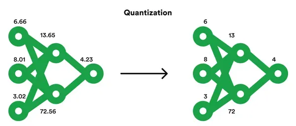

| Jenis                          | Cara kerja singkat                                                            | Efek umum                                                                  |
| ------------------------------ | ----------------------------------------------------------------------------- | -------------------------------------------------------------------------- |
| Dynamic range quantization     | Bobot disimpan 8-bit, aktivasi dihitung dinamis saat inference                | Ukuran model mengecil sekitar 4x, tanpa data kalibrasi                     |
| Float16 quantization           | Bobot disimpan 16-bit float                                                   | Ukuran sekitar setengahnya, akurasi hampir sama, cocok untuk GPU           |
| Full integer quantization      | Bobot dan aktivasi 8-bit integer, butuh _representative dataset_ untuk kalibrasi | Paling kecil dan cepat, cocok untuk hardware khusus integer (misalnya Edge TPU) |

**Pros dan cons quantization:**

-   Pros: ukuran model lebih kecil, inference lebih cepat, konsumsi memori dan daya lebih rendah.
-   Cons: akurasi bisa turun (perlu dievaluasi ulang setelah quantization), tidak semua operasi/layer didukung pada semua format, dan sebagian jenis quantization butuh data kalibrasi.

**Pros dan cons edge deployment secara umum:**

-   Pros: latency rendah (tanpa round-trip ke server), data tetap di perangkat, bisa offline, tidak ada biaya server per request.
-   Cons: sumber daya perangkat terbatas, memperbarui model ke banyak perangkat lebih rumit, dan monitoring lebih sulit karena inference terjadi di perangkat pengguna.

## Batch vs Real-Time Inference

Selain memilih _di mana_ model dijalankan, kita juga perlu menentukan _kapan_ dan _bagaimana_ prediksi dibuat.

| Aspek       | Batch Inference                                                                 | Real-Time (Online) Inference                                                  |
| ----------- | ------------------------------------------------------------------------------- | ----------------------------------------------------------------------------- |
| Cara kerja  | Prediksi dijalankan untuk banyak data sekaligus, biasanya terjadwal             | Prediksi dibuat per request, hasil langsung dikembalikan                      |
| Latency     | Tidak kritis (menit sampai jam)                                                 | Kritis (milidetik sampai detik)                                               |
| Biaya       | Efisien, resource dipakai hanya saat job berjalan                               | Server/endpoint harus siap setiap saat (atau menanggung cold start)           |
| Contoh      | Rekomendasi harian, scoring risiko kredit semalam, klasifikasi arsip gambar     | Deteksi penipuan saat transaksi, demo klasifikasi digit pada panduan ini      |
| Implementasi| Script/job terjadwal (cron, workflow scheduler) yang membaca data dan menyimpan hasil | Service dengan API (misalnya FastAPI) atau endpoint yang selalu tersedia |

Jika hasil prediksi tidak dibutuhkan saat itu juga, batch inference hampir selalu lebih murah dan sederhana. Real-time dipilih ketika pengguna atau sistem menunggu hasilnya. Contoh pada panduan ini (Gradio, FastAPI) adalah real-time inference.

## Contoh

Berikut adalah cara men-deploy model klasifikasi digit TensorFlow. Model dihasilkan oleh [notebook ini](https://www.kaggle.com/code/jasonkmrkn/hands-on-cnn) dan disimpan sebagai `model.keras`. Alurnya:

1. Demo interaktif dengan **Gradio** (menggambar digit langsung di browser).
2. Membungkus model sebagai **API** dengan **FastAPI**.
3. Mengemas API dengan **Docker**.
4. Meng-host demo Gradio di **Modal**.

### Persiapan

1. Jalankan notebook sampai selesai, lalu unduh `model.keras` dari output notebook.

    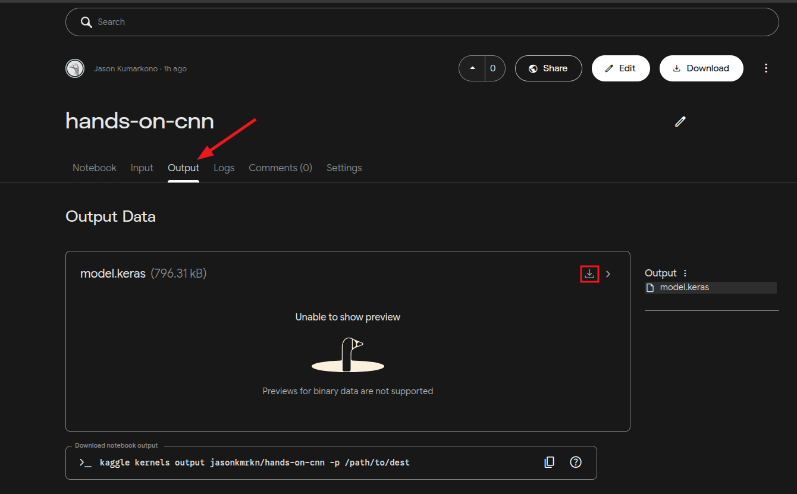

2. Buat folder proyek dan letakkan `model.keras` di dalamnya.

    ```
    digit-classifier/
    ├── model.keras
    ├── preprocess.py
    ├── gradio_app.py
    ├── main.py
    ├── requirements.txt
    ├── requirements-api.txt
    ├── Dockerfile
    └── modal_app.py
    ```

    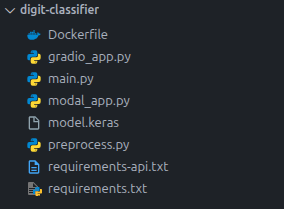

3. (Opsional) Setup virtual environment agar dependency yang akan digunakan tidak mempengaruhi local environment.

-   Windows

    ```bash
    python -m venv .venv
    ./.venv\Scripts\activate
    ```

    > Jika gagal, jalankan Powershell dengan Run As Administrator lalu perbolehkan eksekusi script dengan menjalankan command berikut

    ```ps1
    Set-ExecutionPolicy RemoteSigned
    ```

-   Linux / macOS
    ```bash
    python -m venv .venv
    source .venv/bin/activate
    ```

4. Buat `requirements.txt` (untuk demo Gradio):

    ```text
    tensorflow==2.21.0
    gradio==6.31.0
    pillow
    ```

    Install:

    ```bash
    pip install -r requirements.txt
    ```

    > Gunakan Python 3.10 atau lebih baru. Versi TensorFlow/Keras saat melatih model sebaiknya sama (atau tidak jauh berbeda) dengan versi saat model dimuat.

5. Buat `preprocess.py`. Model menerima gambar **28×28 grayscale dengan nilai piksel 0–255** (tidak perlu normalisasi manual karena sudah ada layer preprocessing di dalam model). Data MNIST berupa angka putih di latar hitam, dengan angka berukuran sekitar 20×20 piksel yang berada di tengah kanvas 28×28. Fungsi ini menyamakan gambar masukan dengan format tersebut.

    ```python
    import numpy as np
    from PIL import Image


    def preprocess(img: Image.Image):
        img = img.convert("L")
        arr = np.array(img)

        # Cari area yang berisi coretan
        ys, xs = np.nonzero(arr > 20)
        if len(xs) == 0:
            return None  # kanvas kosong

        # Crop sekitar digit, skala ke 20 px (sisi terpanjang), lalu letakkan di tengah 28x28
        box = (int(xs.min()), int(ys.min()), int(xs.max()) + 1, int(ys.max()) + 1)
        digit = img.crop(box)
        scale = 20 / max(digit.size)
        new_size = (max(1, round(digit.width * scale)), max(1, round(digit.height * scale)))
        digit = digit.resize(new_size, Image.Resampling.LANCZOS)

        canvas = Image.new("L", (28, 28), 0)
        canvas.paste(digit, ((28 - new_size[0]) // 2, (28 - new_size[1]) // 2))

        return np.array(canvas, dtype="float32").reshape(1, 28, 28, 1)
    ```

### Demo dengan Gradio

Buat `gradio_app.py`:

```python
import gradio as gr
import numpy as np
import tensorflow as tf
from PIL import Image

from preprocess import preprocess

model = tf.keras.models.load_model("model.keras")

CANVAS_SIZE = 280
blank = np.zeros((CANVAS_SIZE, CANVAS_SIZE, 3), dtype=np.uint8)  # latar hitam


def predict(drawing):
    if drawing is None:
        return None, None
    x = preprocess(Image.fromarray(drawing["composite"]))
    if x is None:
        return None, None
    probs = model.predict(x, verbose=0)[0]
    scores = {str(i): float(p) for i, p in enumerate(probs)}
    preview = x[0, :, :, 0].astype("uint8")
    return scores, preview


# Sembunyikan tombol "Clear canvas" bawaan editor (membuat kanvas jadi putih)
CSS = 'button[aria-label="Clear canvas"] { display: none !important; }'

with gr.Blocks(title="Digit Classifier") as demo:
    gr.Markdown("# Digit Classifier\nGambar satu angka dengan kuas putih di kanvas hitam, lalu klik **Predict**.")
    with gr.Row():
        with gr.Column():
            sketch = gr.Sketchpad(
                value=blank,
                canvas_size=(CANVAS_SIZE, CANVAS_SIZE),
                brush=gr.Brush(colors=["#FFFFFF"], default_color="#FFFFFF", default_size=8, color_mode="fixed"),
                label="Gambar satu digit (0-9)",
            )
            with gr.Row():
                clear_btn = gr.Button("Clear")
                predict_btn = gr.Button("Predict", variant="primary")
        with gr.Column():
            label = gr.Label(num_top_classes=3, label="Prediksi")
            preview = gr.Image(label="Input yang dilihat model (28x28)", image_mode="L", width=140, height=140)

    predict_btn.click(predict, inputs=sketch, outputs=[label, preview])
    clear_btn.click(None, js="() => window.location.reload()")  # muat ulang halaman: kanvas kembali hitam

if __name__ == "__main__":
    demo.launch(css=CSS)
```

Jalankan:

```bash
python gradio_app.py
```

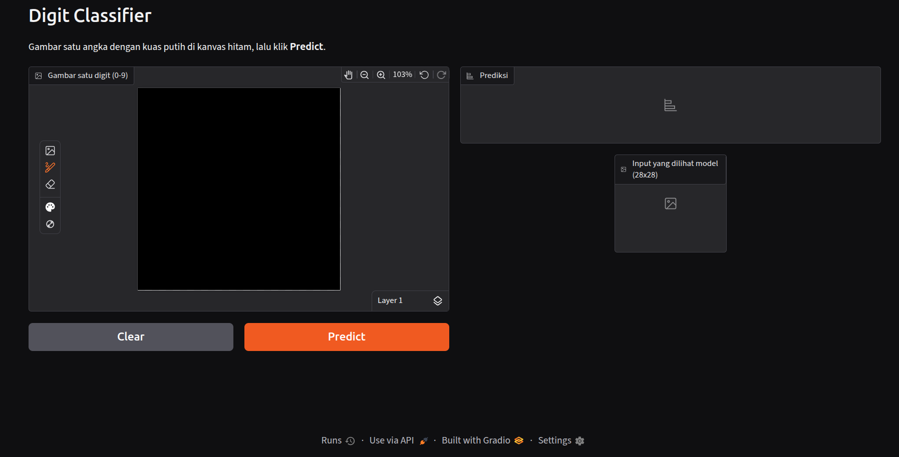

Buka `http://127.0.0.1:7860`, gambar satu digit dengan kuas putih di kanvas hitam, lalu klik **Predict**. Panel kanan menampilkan 3 prediksi teratas beserta gambar 28×28 yang benar-benar dilihat model.

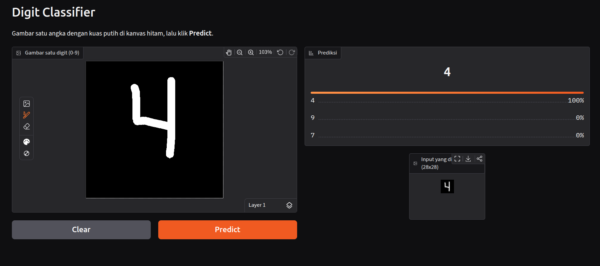

### API dengan FastAPI

Gradio cocok untuk demo interaktif yang digunakan langsung oleh pengguna lewat browser. Jika model akan dipanggil oleh aplikasi lain (web, mobile, atau service lain), bungkus model sebagai API.

1. Buat `requirements-api.txt`:

    ```text
    tensorflow==2.21.0
    fastapi==0.162.0
    uvicorn==0.54.0
    python-multipart
    pillow
    ```

    ```bash
    pip install -r requirements-api.txt
    ```

2. Buat `main.py`. Model dimuat **sekali** saat server start (bukan setiap request).

    ```python
    import io
    from contextlib import asynccontextmanager

    import tensorflow as tf
    from fastapi import FastAPI, File, HTTPException, UploadFile
    from PIL import Image, UnidentifiedImageError

    from preprocess import preprocess

    models = {}


    @asynccontextmanager
    async def lifespan(app: FastAPI):
        models["digit"] = tf.keras.models.load_model("model.keras")  # dimuat sekali saat server start
        yield
        models.clear()


    app = FastAPI(title="Digit Classifier API", lifespan=lifespan)


    @app.get("/health")
    def health():
        return {"status": "ok"}


    @app.post("/predict")
    async def predict(file: UploadFile = File(...)):
        try:
            img = Image.open(io.BytesIO(await file.read()))
        except UnidentifiedImageError:
            raise HTTPException(status_code=400, detail="File bukan gambar yang valid")

        x = preprocess(img)
        if x is None:
            raise HTTPException(status_code=422, detail="Tidak ada digit terdeteksi (gunakan digit putih di latar hitam)")

        probs = models["digit"].predict(x, verbose=0)[0]
        return {
            "prediction": int(probs.argmax()),
            "confidence": float(probs.max()),
            "probabilities": {str(i): float(p) for i, p in enumerate(probs)},
        }
    ```

3. Jalankan server:

    ```bash
    uvicorn main:app --host 0.0.0.0 --port 8000
    ```
    Lalu Buka di browser kalian, `http://0.0.0.0:8000/docs`
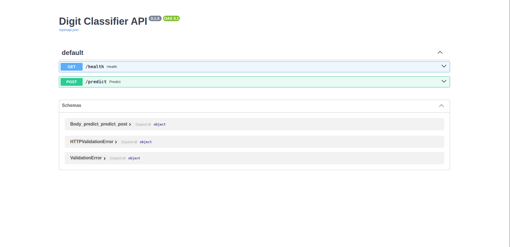
    Kalau berhasil maka muncul seperti gambar di atas.
4. Uji dengan `curl` (gunakan gambar digit putih di latar hitam, misalnya `digit.png`):

    ```bash
    curl -X POST http://localhost:8000/predict -F "file=@digit.png"
    ```

    Contoh respons:

    ```json
    {"prediction": 8, "confidence": 0.98, "probabilities": {"0": 0.0, "1": 0.001, "...": "..."}}
    ```

    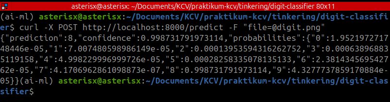

    Dokumentasi interaktif (Swagger UI) tersedia di `http://localhost:8000/docs`.

### Containerization dengan Docker

Docker membungkus aplikasi beserta dependency-nya ke dalam _image_ sehingga berjalan sama di laptop, server, maupun cloud.

1. Buat `Dockerfile`:

    ```dockerfile
    FROM python:3.12-slim

    WORKDIR /app

    COPY requirements-api.txt .
    RUN pip install --no-cache-dir -r requirements-api.txt

    COPY model.keras preprocess.py main.py ./

    EXPOSE 8000
    CMD ["uvicorn", "main:app", "--host", "0.0.0.0", "--port", "8000"]
    ```

    > `requirements-api.txt` disalin dan di-install lebih dulu agar layer dependency di-cache oleh Docker dan tidak dibangun ulang setiap kali kode berubah.

2. Build image:

    ```bash
    docker build -t digit-api .
    ```

    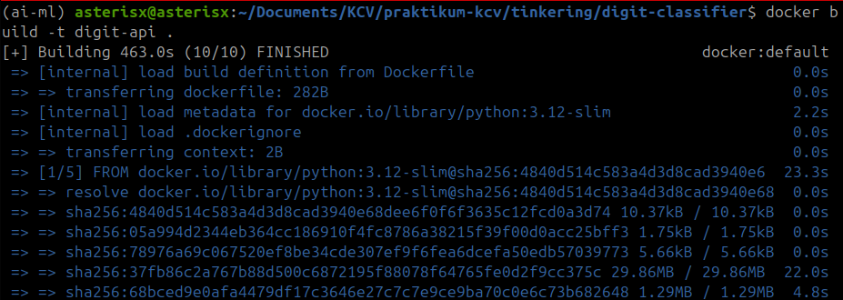

3. Jalankan container:

    ```bash
    docker run --rm -p 8000:8000 digit-api
    ```

4. Uji kembali dengan `curl` seperti pada bagian sebelumnya.

    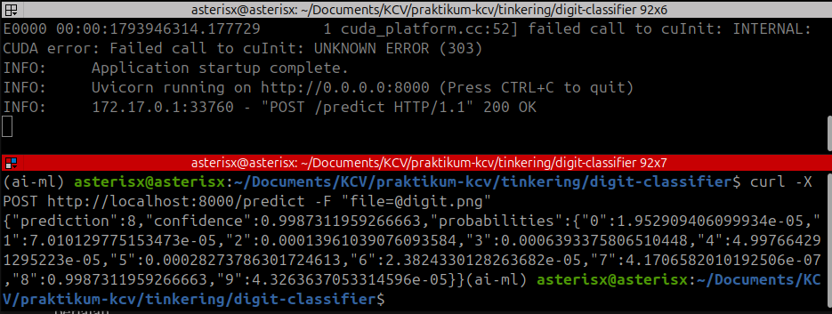

> Image yang sama dapat dijalankan di server cloud, on-premise, atau diunggah ke container registry untuk layanan serverless/managed.

### Hosting dengan Modal

[Modal](https://modal.com) adalah platform serverless (termasuk GPU) di mana aplikasi didefinisikan dengan kode Python. Pada contoh ini, demo Gradio di-host di Modal sehingga bisa diakses lewat URL publik.

**Kredensial yang dibutuhkan.** Dari akun Modal, yang diperlukan adalah **API token** berupa pasangan:

-   `MODAL_TOKEN_ID`
-   `MODAL_TOKEN_SECRET`

Token ini digunakan agar CLI `modal` dapat mengakses workspace Modal kita. Jangan commit token ke repository.
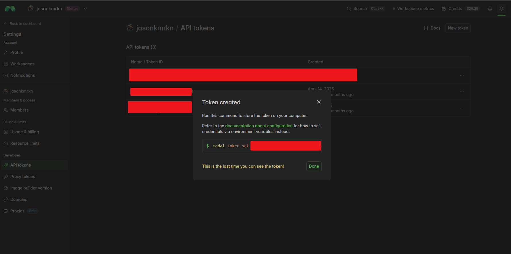

1. Install Modal CLI:

    ```bash
    pip install modal
    ```

2. Autentikasi menggunakan token (salah satu cara):

    ```bash
    modal token set --token-id <MODAL_TOKEN_ID> --token-secret <MODAL_TOKEN_SECRET>
    ```

    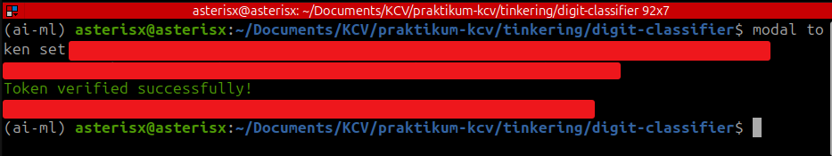

    atau sebagai environment variable:

    ```bash
    export MODAL_TOKEN_ID=<MODAL_TOKEN_ID>
    export MODAL_TOKEN_SECRET=<MODAL_TOKEN_SECRET>
    ```
    > Alternatif interaktif: `modal token new` (membuka browser untuk login).

3. Buat `modal_app.py`:

    ```python
    import modal

    app = modal.App("digit-classifier")

    image = (
        modal.Image.debian_slim(python_version="3.12")
        .pip_install("tensorflow==2.21.0", "gradio==6.31.0", "fastapi[standard]==0.162.0", "pillow")
        .add_local_file("model.keras", "/root/model.keras")
        .add_local_file("preprocess.py", "/root/preprocess.py")
        .add_local_file("gradio_app.py", "/root/gradio_app.py")
    )


    @app.function(
        image=image,
        max_containers=1,       # Gradio membutuhkan sticky session
        scaledown_window=300,   # container dimatikan setelah 5 menit tanpa request
    )
    @modal.concurrent(max_inputs=100)
    @modal.asgi_app()
    def web():
        import os
        import sys

        import gradio as gr
        from fastapi import FastAPI

        sys.path.insert(0, "/root")
        os.chdir("/root")
        from gradio_app import demo, CSS

        return gr.mount_gradio_app(app=FastAPI(), blocks=demo.queue(), path="/", css=CSS)
    ```

    > `max_containers=1` dipakai karena Gradio membutuhkan request dari satu sesi diarahkan ke container yang sama. Untuk demo satu-dua pengguna ini sudah cukup.

4. Jalankan mode development (URL sementara, otomatis reload saat file berubah):

    ```bash
    modal serve modal_app.py
    ```

    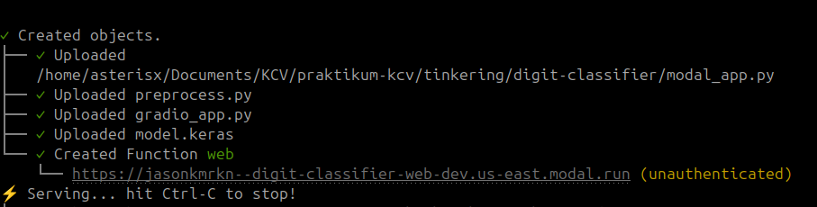

    Kalian bisa cek hasil nya sebelum di deploy dengan cara klik link yang dihasilkan.

5. Jika sudah puas, deploy:

    ```bash
    modal deploy modal_app.py
    ```

    Modal akan menampilkan URL aplikasi (berformat `https://<workspace>--digit-classifier-web.modal.run`).

    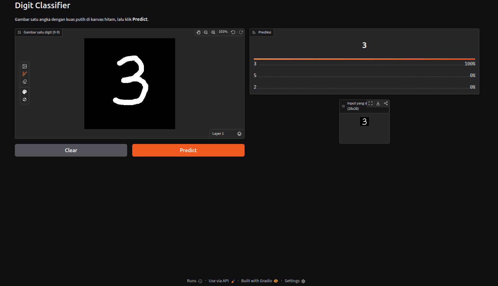

> Request pertama setelah aplikasi lama tidak dipakai akan lebih lambat (_cold start_) karena container dan model harus dimuat. Untuk menghindarinya, dapat diatur `min_containers=1`, dengan konsekuensi container tetap aktif dan menimbulkan biaya.

### Menjalankan di GPU dengan Modal

Untuk menjalankan aplikasi yang sama di GPU, hanya ada dua perubahan pada `modal_app.py`:

1. Install TensorFlow dengan library CUDA: `tensorflow[and-cuda]`.
2. Minta GPU pada function dengan parameter `gpu`.

Buat file baru `modal_app_gpu.py` (`gradio_app.py`, `preprocess.py`, dan `model.keras` tidak berubah):

```python
import modal

app = modal.App("digit-classifier-gpu")

image = (
    modal.Image.debian_slim(python_version="3.12")
    .pip_install("tensorflow[and-cuda]==2.21.0", "gradio==6.31.0", "fastapi[standard]==0.162.0", "pillow")
    .add_local_file("model.keras", "/root/model.keras")
    .add_local_file("preprocess.py", "/root/preprocess.py")
    .add_local_file("gradio_app.py", "/root/gradio_app.py")
)


@app.function(
    image=image,
    gpu="T4",               # minta GPU T4 untuk function ini
    max_containers=1,
    scaledown_window=300,
)
@modal.concurrent(max_inputs=100)
@modal.asgi_app()
def web():
    import os
    import sys

    import gradio as gr
    import tensorflow as tf
    from fastapi import FastAPI

    print("GPU terdeteksi:", tf.config.list_physical_devices("GPU"))

    sys.path.insert(0, "/root")
    os.chdir("/root")
    from gradio_app import demo, CSS

    return gr.mount_gradio_app(app=FastAPI(), blocks=demo.queue(), path="/", css=CSS)
```

Jalankan seperti sebelumnya:

```bash
modal serve modal_app_gpu.py
```

Pada log terminal, baris `GPU terdeteksi: [PhysicalDevice(name='/physical_device:GPU:0', device_type='GPU')]` menandakan GPU berhasil dipakai. Jika hasilnya `[]`, GPU tidak terdeteksi oleh TensorFlow.

Jenis GPU lain (misalnya `"L4"` atau `"A100"`) dipilih dengan mengganti nilai `gpu`. Daftar GPU dan tarifnya ada di [modal.com/pricing](https://modal.com/pricing).

## Monitoring dan MLOps

Deployment bukan akhir dari pekerjaan. Model di production perlu dipantau dan dirawat. Praktik ini dikenal sebagai **MLOps**.

-   **Logging.** Catat request, prediksi, confidence, latency, dan error. Log menjadi dasar untuk mengetahui apakah model dipakai sebagaimana mestinya dan di mana ia gagal. Perhatikan privasi: jangan menyimpan data sensitif tanpa alasan dan izin yang jelas.
-   **Model versioning.** Simpan setiap versi model (beserta kode, data, dan hyperparameter pelatihannya) dengan penamaan yang jelas, misalnya `model-v1.keras`, `model-v2.keras`. Dengan begitu kita dapat melacak versi mana yang sedang berjalan dan melakukan _rollback_ bila versi baru bermasalah.
-   **Data drift.** Data di production bisa berbeda dari data pelatihan seiring waktu (misalnya gaya tulisan tangan pengguna berbeda dari MNIST, atau kualitas kamera berubah). Pantau distribusi input dan distribusi prediksi/confidence. Penurunan confidence atau pergeseran distribusi adalah tanda awal bahwa model mulai tidak cocok dengan data nyata.
-   **Retraining.** Ketika performa menurun, latih ulang model dengan data baru (dapat dijadwalkan atau dipicu oleh sinyal drift), evaluasi terhadap versi sebelumnya, lalu rilis sebagai versi baru dengan versioning yang rapi.

Platform managed endpoint umumnya menyediakan sebagian besar fitur ini secara bawaan. Jika kita men-deploy sendiri (seperti contoh di atas), kita yang perlu menyiapkannya.

## Referensi

-   [Gradio Documentation](https://www.gradio.app/docs)
-   [FastAPI Documentation](https://fastapi.tiangolo.com/)
-   [Docker Documentation](https://docs.docker.com/)
-   [Modal Documentation](https://modal.com/docs)
-   [TensorFlow Keras API](https://www.tensorflow.org/api_docs/python/tf/keras)
-   [TensorFlow Lite](https://www.tensorflow.org/lite)
-   [ONNX Runtime](https://onnxruntime.ai/)
