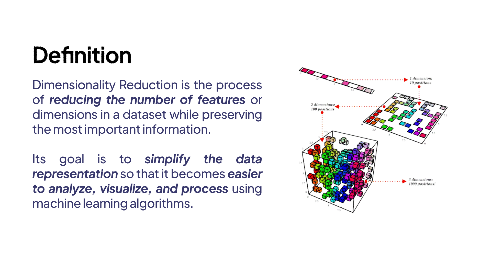
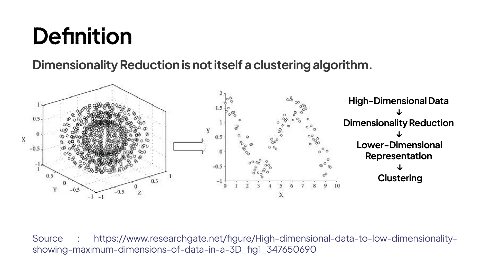
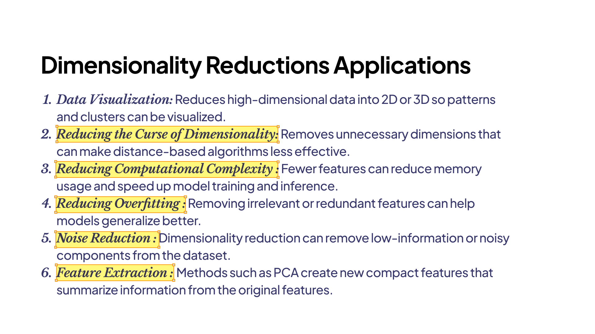
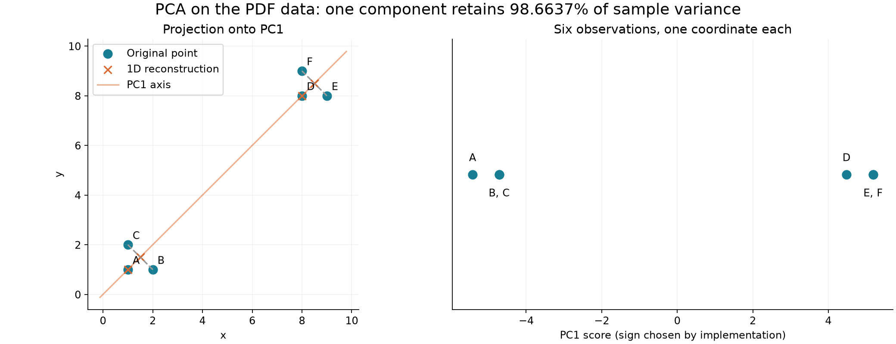
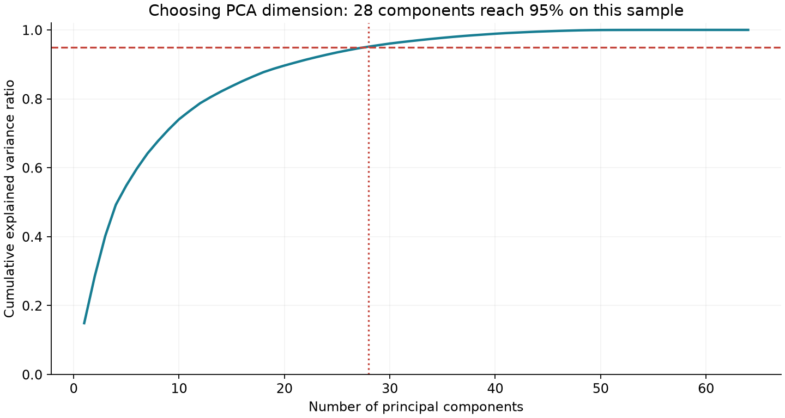
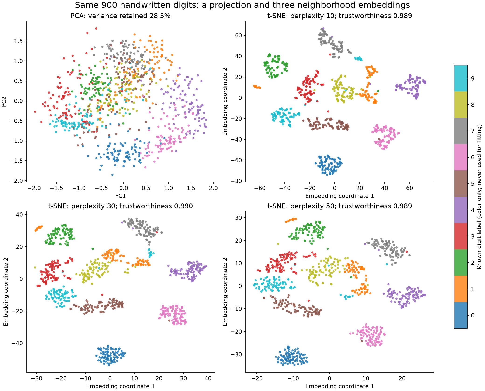

# Dimensionality Reduction

## Daftar Isi

- [Definisi](#definisi)
- [Tujuan](#tujuan)
- [Feature Selection dan Feature Extraction](#feature-selection-dan-feature-extraction)
- [Jenis Metode](#jenis-metode)
- [Persiapan Data](#persiapan-data)
- [Principal Component Analysis](#principal-component-analysis)
- [t-SNE](#t-sne)
- [Perbedaan PCA dan t-SNE](#perbedaan-pca-dan-t-sne)
- [UMAP](#umap)
- [Metode Dimensionality Reduction Lainnya](#metode-dimensionality-reduction-lainnya)
- [Evaluasi](#evaluasi)
- [Implementasi](#implementasi)
- [Hubungan dengan Clustering](#hubungan-dengan-clustering)
- [Memilih Metode](#memilih-metode)
- [Kelebihan](#kelebihan)
- [Kekurangan](#kekurangan)
- [Latihan](#latihan)
- [Referensi](#referensi)

## Definisi

**Dimensionality reduction** adalah proses mengurangi jumlah fitur yang digunakan untuk merepresentasikan data. Tujuannya adalah memperoleh representasi yang lebih ringkas sambil mempertahankan informasi yang relevan terhadap kebutuhan analisis.

Misalkan terdapat n data dengan d fitur. Dataset tersebut dapat ditulis sebagai matriks:

$$
X\in\mathbb{R}^{n\times d}.
$$

Setelah dimensionality reduction, representasinya menjadi:

$$
Z\in\mathbb{R}^{n\times q},\qquad q<d.
$$

Jumlah data tetap n, sedangkan jumlah koordinat untuk setiap data berkurang dari d menjadi q. Sebagai contoh, 1.000 gambar yang masing-masing direpresentasikan oleh embedding 768 dimensi dapat diubah menjadi matriks berukuran 1.000 × 32. Jika tujuannya membuat scatter plot, representasi dapat dikurangi menjadi dua dimensi.

Dua dimensi memudahkan visualisasi, tetapi belum tentu cukup untuk klasifikasi, pencarian kemiripan, atau clustering. Jumlah dimensi sebaiknya mengikuti tujuan penggunaannya.

*Ilustrasi pengurangan jumlah dimensi. Sumber: materi Unsupervised Learning, LBE KCV 2026, halaman 55.*

Dimensionality reduction juga berbeda dengan clustering. PCA dan t-SNE menghasilkan koordinat baru, sedangkan algoritma clustering menentukan keanggotaan kelompok. Keduanya dapat digunakan secara berurutan, tetapi tidak memiliki fungsi yang sama.

*Representasi berdimensi rendah dapat digunakan sebagai input clustering. Sumber: materi Unsupervised Learning, LBE KCV 2026, halaman 56.*

## Tujuan

*Beberapa penggunaan dimensionality reduction. Sumber: materi Unsupervised Learning, LBE KCV 2026, halaman 57.*

### 1. Memudahkan Visualisasi

Data dengan dua atau tiga fitur dapat ditampilkan secara langsung. Untuk data dengan ratusan fitur, dimensionality reduction membantu membuat representasi yang bisa diamati melalui plot.

Visualisasi dapat membantu menemukan pola kedekatan, data yang berbeda dari mayoritas, atau kelompok yang perlu diperiksa lebih lanjut. Namun, plot merupakan ringkasan sehingga sebagian hubungan dalam data asli dapat berubah atau hilang.

### 2. Mengurangi Beban Komputasi

Representasi yang lebih kecil dapat mengurangi kebutuhan penyimpanan dan perhitungan pada model berikutnya. Sebagai contoh, menghitung jarak pada 40 fitur dapat lebih ringan daripada pada 10.000 fitur.

Penghematan ini perlu dibandingkan dengan biaya proses reduksinya. Metode yang membangun seluruh jarak berpasangan dapat membutuhkan waktu dan memori besar, terutama jika jumlah data banyak.

### 3. Mengurangi Redundansi dan Noise

Beberapa fitur dapat membawa informasi yang serupa. Jika banyak pengukuran mengikuti perubahan faktor yang sama, representasi yang lebih ringkas dapat merangkum pola tersebut.

Pengurangan dimensi juga dapat membantu membuang variasi yang tidak relevan. Namun, metode tidak selalu mengetahui variasi mana yang merupakan noise. Informasi penting dapat ikut terbuang jika kriteria reduksi tidak sesuai dengan masalah.

### 4. Mengurangi Pengaruh Curse of Dimensionality

Pada ruang berdimensi tinggi, data dapat menjadi sangat jarang dibandingkan dengan luas ruang yang mungkin ditempati. Jika setiap dimensi dibagi menjadi m bagian, grid dengan d dimensi memiliki m^d sel.

Keadaan ini dapat membuat estimasi kedekatan dan kepadatan menjadi sulit ketika jumlah sampel terbatas. Mengurangi fitur yang tidak relevan dapat membantu, tetapi tidak berarti seluruh jarak pada data berdimensi tinggi selalu tidak berguna. Kualitas jarak tetap bergantung pada representasi, distribusi data, dan metric yang digunakan.

### 5. Membentuk Fitur untuk Model

Hasil reduksi dapat menjadi input untuk klasifikasi, regresi, retrieval, atau clustering. Manfaatnya perlu diukur melalui tugas tersebut. Representasi yang menghasilkan plot menarik belum tentu memberi hasil prediksi yang lebih baik.

## Feature Selection dan Feature Extraction

**Feature selection** mempertahankan sebagian fitur asli. Misalnya, dari data pelanggan dipilih fitur frekuensi pembelian dan total belanja, lalu kolom identifier serta fitur yang tidak relevan dikeluarkan.

**Feature extraction** membentuk fitur baru dari fitur yang tersedia. Komponen PCA, misalnya, merupakan kombinasi linear beberapa fitur asli. Nilainya tidak lagi langsung berarti satu fitur seperti pendapatan atau jumlah pembelian.

| Aspek | Feature Selection | Feature Extraction |
|---|---|---|
| Cara mengurangi dimensi | Memilih sebagian kolom | Membentuk koordinat atau komponen baru |
| Makna output | Masih menggunakan fitur asli | Memerlukan interpretasi terhadap transformasi |
| Contoh | Menghapus fitur konstan atau memilih subset yang relevan | PCA, Truncated SVD, dan autoencoder |
| Informasi yang dibuang | Fitur yang tidak dipilih | Bagian informasi yang tidak dipertahankan transformasi |

Pengurangan dimensi tidak harus menghasilkan koordinat yang mudah dijelaskan secara semantik. Karena itu, interpretasi fitur baru perlu dibedakan dari interpretasi fitur asli.

## Jenis Metode

### Metode Linear dan Nonlinear

Metode linear menghasilkan koordinat melalui kombinasi linear fitur. PCA dan Truncated SVD termasuk kelompok ini. Metode nonlinear dapat merepresentasikan hubungan yang tidak tertangkap oleh satu subruang linear, misalnya Kernel PCA, Isomap, t-SNE, dan autoencoder nonlinear.

### Transformasi untuk Data Baru

Sebagian metode mempelajari transformasi yang dapat diterapkan pada data baru. PCA menggunakan rata-rata dan arah komponen yang telah dipelajari. Autoencoder menggunakan encoder.

Metode lain terutama membentuk koordinat untuk kumpulan data yang sedang dianalisis. Implementasi standar `TSNE` pada scikit-learn tidak menyediakan `transform` untuk memetakan data baru ke ruang yang sudah terbentuk.

| Metode | Prinsip utama | Contoh penggunaan | Pemetaan data baru pada implementasi yang dibahas |
|---|---|---|---|
| PCA | Mempertahankan variasi melalui subruang linear | Kompresi dan preprocessing numerik | Tersedia melalui `transform` |
| Incremental PCA | Memperkirakan komponen PCA secara bertahap | Data yang diproses per batch | Tersedia |
| Kernel PCA | PCA pada ruang fitur yang ditentukan kernel | Representasi nonlinear | Tersedia berdasarkan data yang telah dipasang |
| Truncated SVD | Faktorisasi rank rendah tanpa centering wajib | Matriks teks sparse | Tersedia |
| ICA | Memisahkan komponen yang independen | Pemisahan sinyal | Tersedia |
| NMF | Faktorisasi aditif dengan nilai nonnegatif | Komponen citra atau tema teks | Tersedia dengan mencari koefisien nonnegatif |
| Factor Analysis | Faktor bersama dan noise per fitur | Pemodelan variabel laten | Tersedia |
| Random Projection | Proyeksi linear acak | Kompresi pendekatan berbasis jarak | Tersedia |
| MDS | Mencocokkan jarak dengan dissimilarity | Visualisasi hubungan antar objek | Tidak ada `transform` umum pada scikit-learn |
| Isomap | Mempertahankan pendekatan jarak geodesik | Eksplorasi manifold | Tersedia pada scikit-learn |
| LLE | Mempertahankan bobot rekonstruksi lokal | Eksplorasi manifold | Tersedia pada scikit-learn |
| Spectral Embedding | Eigenvector dari graph Laplacian | Representasi graph kedekatan | Tidak ada `transform` umum pada scikit-learn |
| t-SNE | Mencocokkan probabilitas kedekatan | Visualisasi dua atau tiga dimensi | Tidak ada `transform` standar pada scikit-learn |
| UMAP | Mewakili struktur graph kedekatan | Visualisasi atau fitur untuk model | Tersedia pada implementasi umap-learn |
| Autoencoder | Mempelajari encoder dan decoder | Representasi nonlinear | Menggunakan encoder |

Ada pula metode reduksi dimensi yang menggunakan label, misalnya **Linear Discriminant Analysis**. Metode tersebut dibahas sebagai pembanding pada bagian berikutnya dan termasuk supervised learning.

## Persiapan Data

### Scaling dan Normalization

Fitur dengan rentang besar dapat mendominasi perhitungan variasi maupun jarak. Standardization menggunakan:

$$
\widetilde{x}_{ij}=\frac{x_{ij}-m_j}{s_j},
$$

dengan m_j dan s_j sebagai rata-rata serta standar deviasi fitur j pada data training.

Scaling bukan aturan yang harus diterapkan dengan cara sama untuk seluruh dataset. Fitur dengan satuan berbeda sering memerlukan penyetaraan skala. Sebaliknya, pada fitur yang sudah sebanding, perbedaan variasinya mungkin memang bermakna.

Ada beberapa hal yang perlu dibedakan:

- **Centering** mengurangi setiap fitur dengan rata-ratanya.
- **Standardization** juga membagi fitur dengan standar deviasi.
- **Normalization** dapat merujuk pada penyesuaian panjang setiap vektor, misalnya menjadi unit norm.

Implementasi `PCA` pada scikit-learn melakukan centering, tetapi tidak otomatis membuat varians seluruh fitur sama. Informasi ini dijelaskan pada [dokumentasi PCA](https://scikit-learn.org/stable/modules/generated/sklearn.decomposition.PCA.html).

Untuk embedding yang memang dirancang memakai cosine similarity, perubahan normalization perlu dipertimbangkan berdasarkan tujuan representasinya. Pada NMF, preprocessing harus tetap menghasilkan nilai nonnegatif. Pada data sparse, pengurangan rata-rata setiap kolom dapat membuat matriks menjadi dense.

### Missing Value dan Outlier

Missing value perlu ditangani sesuai karakter data sebelum transformasi. Outlier juga perlu diperiksa karena dapat mengubah arah PCA atau struktur tetangga pada metode nonlinear.

Outlier yang berasal dari kesalahan pencatatan berbeda dengan kasus langka yang valid. Keputusan menghapus atau mempertahankannya perlu mengikuti masalah yang dianalisis.

### Menghindari Data Leakage

Untuk mengevaluasi model prediksi, pisahkan data terlebih dahulu. Imputer, scaler, dimensionality reduction, dan model akhir dipasang pada bagian training, lalu diterapkan pada validation atau test set.

Jika menggunakan cross-validation, transformasi juga harus dipasang ulang di setiap training fold. `Pipeline` membantu menjaga urutan tersebut.

Untuk eksplorasi satu dataset, membuat peta dari seluruh data dapat dilakukan. Namun, hasil eksplorasi tersebut berbeda dengan pengujian kemampuan model pada data baru yang belum digunakan saat fitting.

## Principal Component Analysis

### Definisi dan Intuisi

**Principal Component Analysis (PCA)** mencari arah baru yang saling tegak lurus dan mempertahankan variasi data sebesar mungkin. Arah pertama menangkap varians terbesar. Arah kedua menangkap varians terbesar yang tersisa dengan syarat tegak lurus terhadap arah pertama.

Bayangkan titik-titik yang membentuk kumpulan memanjang secara diagonal. Jika hanya memakai sumbu horizontal, sebagian perubahan data dapat hilang. PCA memilih arah yang mengikuti penyebaran utama titik-titik tersebut.

Jika seluruh komponen dipakai, PCA terutama mengubah sistem koordinat. Pengurangan dimensi terjadi ketika hanya sebagian komponen yang dipertahankan.

### Notasi

| Simbol | Makna |
|---|---|
| X | Matriks n data dengan d fitur |
| μ | Vektor rata-rata fitur |
| X_c | Matriks setelah centering |
| S | Matriks covariance |
| W_q | q arah komponen utama sebagai kolom |
| Z | Koordinat hasil proyeksi |
| λ_j | Varians pada komponen ke-j |
| X̂ | Rekonstruksi pada ruang fitur awal |

### 1. Melakukan Centering

Rata-rata setiap fitur membentuk vektor:

$$
\boldsymbol{\mu}=\frac{1}{n}\sum_{i=1}^{n}\mathbf{x}_i.
$$

Jika setiap baris adalah satu data, matriks setelah centering adalah:

$$
X_c=X-\mathbf{1}\boldsymbol{\mu}^{\top}.
$$

PCA kemudian menganalisis variasi terhadap rata-rata tersebut. Jika standardization diperlukan, prosesnya dilakukan sebelum PCA.

### 2. Menghitung Covariance

Matriks sample covariance dihitung dengan:

$$
S=\frac{1}{n-1}X_c^{\top}X_c.
$$

Nilai diagonal menunjukkan varians masing-masing fitur. Nilai di luar diagonal menunjukkan perubahan bersama antara dua fitur.

Pembagi n-1 mengikuti definisi sample covariance. Menggunakan pembagi n akan mengubah skala eigenvalue secara seragam, tetapi tidak mengubah arah eigenvector.

### 3. Mencari Eigenvector dan Eigenvalue

Untuk arah unit w, varians hasil proyeksi adalah wᵀSw. Arah komponen pertama dicari melalui:

$$
\max_{\|\mathbf{w}\|_2=1}\mathbf{w}^{\top}S\mathbf{w}.
$$

Dengan pengali Lagrange, kondisi optimumnya menghasilkan:

$$
S\mathbf{w}=\lambda\mathbf{w}.
$$

Artinya, arah komponen merupakan eigenvector matriks covariance, sedangkan eigenvalue menyatakan varians pada arah tersebut. Komponen diurutkan sehingga:

$$
\lambda_1\ge\lambda_2\ge\cdots\ge\lambda_d\ge0.
$$

Ambil q eigenvector dengan eigenvalue terbesar dan susun sebagai kolom W_q yang berukuran d × q.

### 4. Memproyeksikan Data

Koordinat baru diperoleh melalui:

$$
Z=X_cW_q.
$$

Hasilnya berukuran n × q. Untuk data baru, gunakan rata-rata dan arah komponen dari training. Jangan membentuk basis PCA terpisah pada test set lalu menganggap koordinatnya sama dengan basis training.

### 5. Melakukan Rekonstruksi

Representasi berdimensi rendah dapat dikembalikan menjadi pendekatan pada fitur awal:

$$
\widehat{X}=ZW_q^{\top}+\mathbf{1}\boldsymbol{\mu}^{\top}.
$$

Rekonstruksi umumnya tidak persis sama jika sebagian komponen dibuang. PCA ortogonal memilih subruang yang meminimalkan squared reconstruction error:

$$
\min_{W_q^{\top}W_q=I}\|X_c-X_cW_qW_q^{\top}\|_F^2.
$$

Dengan demikian, mempertahankan varians terbesar setara dengan meminimalkan error rekonstruksi linear dalam formulasi ini. Tujuan tersebut tidak otomatis sama dengan memaksimalkan accuracy atau mempertahankan seluruh perbedaan yang bermakna secara semantik.

### Hubungan dengan Singular Value Decomposition

PCA dapat dihitung tanpa membentuk matriks covariance secara eksplisit. Jika:

$$
X_c=U\Sigma V^{\top},
$$

maka kolom V merupakan arah komponen utama. Untuk q komponen:

$$
Z=X_cV_q=U_q\Sigma_q,\qquad\lambda_j=\frac{\sigma_j^2}{n-1}.
$$

Hubungan ini menjadi dasar beberapa solver PCA. Pemilihan solver memengaruhi kebutuhan memori, kecepatan, dan penggunaan pendekatan numerik.

### Explained Variance Ratio

Proporsi varians yang dijelaskan komponen j adalah:

$$
\mathrm{EVR}_j=\frac{\lambda_j}{\sum_{r=1}^{d}\lambda_r}.
$$

Proporsi kumulatif q komponen adalah:

$$
R_q=\sum_{j=1}^{q}\mathrm{EVR}_j.
$$

Jika R_q = 0.95, subruang tersebut mempertahankan 95% sample variance pada fitur yang diberikan ke PCA. Nilai itu bukan accuracy 95% dan bukan jaminan bahwa 95% informasi penting untuk setiap tugas masih tersimpan.

Jumlah squared reconstruction error berkaitan dengan varians yang dibuang:

$$
\|X-\widehat{X}\|_F^2=(n-1)\sum_{j=q+1}^{d}\lambda_j.
$$

### Contoh Perhitungan PCA

Gunakan data enam titik yang sama dengan contoh clustering:

$$
X=\begin{bmatrix}1&1\\2&1\\1&2\\8&8\\9&8\\8&9\end{bmatrix}.
$$

Rata-rata kedua fitur adalah 29/6, sekitar 4.8333. Matriks covariance-nya adalah:

$$
S=\begin{bmatrix}449/30&437/30\\437/30&449/30\end{bmatrix}
\approx\begin{bmatrix}14.9667&14.5667\\14.5667&14.9667\end{bmatrix}.
$$

Eigenvector dan eigenvalue yang sudah diurutkan dapat ditulis sebagai:

$$
\mathbf{w}_1=\frac{1}{\sqrt2}(1,1)^{\top},\qquad\lambda_1=443/15,
$$

$$
\mathbf{w}_2=\frac{1}{\sqrt2}(1,-1)^{\top},\qquad\lambda_2=2/5.
$$

Jika hanya komponen pertama dipertahankan, koordinat setiap titik menjadi:

$$
z_i=\frac{x_i+y_i-29/3}{\sqrt2}.
$$

| Titik | Koordinat awal | Score PC1 | Rekonstruksi satu komponen |
|---|---|---:|---|
| A | (1, 1) | -5.4212 | (1, 1) |
| B | (2, 1) | -4.7140 | (1.5, 1.5) |
| C | (1, 2) | -4.7140 | (1.5, 1.5) |
| D | (8, 8) | 4.4783 | (8, 8) |
| E | (9, 8) | 5.1854 | (8.5, 8.5) |
| F | (8, 9) | 5.1854 | (8.5, 8.5) |

B dan C memiliki score yang sama karena perbedaannya terletak pada arah komponen kedua yang dibuang. Hal yang sama terjadi pada E dan F.

Varians yang dipertahankan adalah:

$$
R_1=\frac{443/15}{443/15+2/5}=\frac{443}{449}\approx0.986637.
$$

Satu komponen mempertahankan sekitar 98.6637% sample variance. Namun, perbedaan antara B dan C hilang sepenuhnya. Contoh ini menunjukkan bahwa retained variance yang tinggi tetap dapat disertai hilangnya informasi tertentu.

Jumlah squared reconstruction error adalah:

$$
(n-1)\lambda_2=5(0.4)=2.
$$

Titik B, C, E, dan F masing-masing menyumbang error 0.5. Titik A dan D tidak memiliki error rekonstruksi karena berada pada arah yang dipertahankan.

*Hasil PCA pada enam titik contoh. Titik dengan score sama bertumpuk pada representasi satu dimensi.*

Error ini berbeda dengan WCSS pada K-Means. PCA mendekati data dengan subruang, sedangkan K-Means mendekati data dengan sejumlah centroid.

### Menentukan Jumlah Komponen

Jumlah komponen dapat dipilih menggunakan cumulative explained variance, scree plot, kebutuhan error rekonstruksi, atau hasil model berikutnya pada validation set.

Ambang 95% merupakan pilihan praktis, bukan nilai yang selalu optimal. Dua komponen mungkin cukup untuk plot, tetapi model prediksi dapat membutuhkan puluhan komponen.

*Pada sampel 900 citra digit yang digunakan dalam contoh implementasi, 28 komponen mencapai retained variance 95%. Hasil ini mengikuti sampel dan preprocessing tersebut.*

### Score, Loading, dan Whitening

**Score** adalah koordinat setiap data pada komponen. Arah komponen menunjukkan kombinasi fitur yang membentuk koordinat tersebut. Pada scikit-learn, `components_` berukuran `(q, d)`, sedangkan hasil `transform` berukuran `(n, q)`.

Istilah **loading** digunakan dengan beberapa konvensi. Ada yang merujuk pada koefisien eigenvector, ada pula yang mengalikannya dengan akar eigenvalue. Karena itu, makna loading perlu dijelaskan saat menyajikan tabel interpretasi.

Tanda eigenvector tidak mengubah subruangnya. Arah (1, 1) dan (-1, -1) mewakili garis yang sama dengan orientasi berlawanan. Ketika eigenvalue sama atau hampir sama, arah masing-masing komponen juga dapat berubah di dalam subruang yang setara.

PCA menghasilkan score yang tidak berkorelasi secara linear pada data fitting. Kondisi ini tidak sama dengan independensi statistik.

**Whitening** menambahkan penyesuaian skala agar komponen yang dipertahankan memiliki varians satu:

$$
Z_{\text{white}}=Z\,\operatorname{diag}(\lambda_1^{-1/2},\ldots,\lambda_q^{-1/2}).
$$

Whitening mengubah geometri yang diterima model berikutnya. Komponen dengan varians kecil mendapat skala relatif lebih besar sehingga noise pada arah tersebut dapat ikut diperkuat. Manfaatnya perlu diuji sesuai tugas.

## t-SNE

### Definisi dan Intuisi

**t-distributed Stochastic Neighbor Embedding (t-SNE)** membentuk representasi berdimensi rendah dengan mempertahankan hubungan kedekatan antar data melalui distribusi probabilitas.

Jika PCA mencari arah linear dengan varians terbesar, t-SNE mencari susunan titik yang dapat mewakili tetangga-tetangga penting dalam ruang asli. Karena itu, t-SNE sering digunakan untuk eksplorasi dua atau tiga dimensi ketika pola lokal sulit terlihat pada proyeksi linear.

Penjelasan probabilitas dan fungsi objektifnya mengikuti metode yang diperkenalkan van der Maaten dan Hinton dalam [Visualizing Data using t-SNE](https://www.jmlr.org/papers/v9/vandermaaten08a.html).

### 1. Mengubah Jarak Menjadi Probabilitas Kedekatan

Untuk input Euclidean, kedekatan titik j terhadap i dapat ditulis sebagai:

$$
p_{j\mid i}=\frac{\exp(-\|\mathbf{x}_i-\mathbf{x}_j\|_2^2/(2\sigma_i^2))}
{\sum_{k\ne i}\exp(-\|\mathbf{x}_i-\mathbf{x}_k\|_2^2/(2\sigma_i^2))},\qquad p_{i\mid i}=0.
$$

Titik yang lebih dekat mendapat probabilitas lebih besar. Bandwidth σ_i dapat berbeda pada setiap titik sehingga skala kedekatan menyesuaikan kepadatan lokal.

### 2. Menentukan Perplexity

Perplexity ditentukan dari entropy distribusi tetangga:

$$
\operatorname{Perp}(P_i)=2^{H(P_i)},\qquad
H(P_i)=-\sum_{j\ne i}p_{j\mid i}\log_2p_{j\mid i}.
$$

Jika probabilitas tersebar merata pada m tetangga, perplexity-nya adalah m. Hubungan ini memberi intuisi bahwa perplexity mewakili ukuran tetangga efektif.

Perplexity bukan jumlah klaster dan bukan jumlah tetangga tetap untuk seluruh keadaan. Nilai lebih kecil menekankan hubungan yang lebih lokal. Nilai lebih besar melibatkan lingkungan yang lebih luas.

Pada implementasi scikit-learn, perplexity harus lebih kecil daripada jumlah sampel. Nilai 30 sering digunakan sebagai titik awal, tetapi beberapa nilai perlu dibandingkan agar pola yang ditafsirkan tidak hanya muncul pada satu pengaturan.

### 3. Membentuk Probabilitas Simetris

Probabilitas bersyarat digabungkan menjadi:

$$
p_{ij}=\frac{p_{j\mid i}+p_{i\mid j}}{2n},\qquad p_{ii}=0.
$$

Matriks P menyatakan hubungan kedekatan yang akan diwakili oleh embedding. Jumlah probabilitasnya satu jika dihitung untuk seluruh pasangan berurutan yang berbeda.

### 4. Menentukan Probabilitas pada Ruang Hasil

Untuk formulasi t-SNE dua dimensi yang umum, titik hasil y_i dibandingkan menggunakan kernel Student-t dengan satu degree of freedom:

$$
q_{ij}=\frac{(1+\|\mathbf{y}_i-\mathbf{y}_j\|_2^2)^{-1}}
{\sum_{k\ne l}(1+\|\mathbf{y}_k-\mathbf{y}_l\|_2^2)^{-1}},\qquad q_{ii}=0.
$$

Distribusi berekor lebih tebal ini membantu menangani **crowding problem**, yaitu banyak hubungan dalam ruang berdimensi tinggi harus ditempatkan pada ruang yang jauh lebih kecil. Walaupun demikian, tidak semua hubungan dapat dipertahankan tanpa distorsi.

### 5. Meminimalkan KL Divergence

Fungsi objektifnya adalah:

$$
C=\operatorname{KL}(P\|Q)=\sum_{i\ne j}p_{ij}\log\frac{p_{ij}}{q_{ij}}.
$$

Pasangan yang memiliki probabilitas kedekatan besar pada ruang asli diharapkan tetap memiliki kedekatan pada embedding. Kehilangan hubungan tetangga yang kuat mendapat penalti besar dalam fungsi ini.

Gradien untuk formulasi tersebut dapat ditulis sebagai:

$$
\frac{\partial C}{\partial\mathbf{y}_i}
=4\sum_j(p_{ij}-q_{ij})\frac{\mathbf{y}_i-\mathbf{y}_j}{1+\|\mathbf{y}_i-\mathbf{y}_j\|_2^2}.
$$

Secara intuitif, optimasi mengatur keseimbangan interaksi tarik dan tolak antar titik. Fungsi objektifnya tidak convex sehingga inisialisasi dan pengaturan optimasi dapat menghasilkan susunan berbeda.

### Parameter Penting

| Parameter | Fungsi | Hal yang perlu diperhatikan |
|---|---|---|
| `n_components` | Jumlah dimensi hasil | Umumnya dua atau tiga untuk visualisasi |
| `perplexity` | Mengatur skala tetangga efektif | Tidak menentukan jumlah kelompok |
| `init` | Menentukan posisi awal | Inisialisasi PCA tidak mengubah objektif menjadi PCA |
| `learning_rate` | Mengatur besar langkah optimasi | Pengaturan yang tidak sesuai dapat mengganggu hasil |
| `early_exaggeration` | Memperkuat pengaruh kedekatan pada tahap awal | Memengaruhi proses pembentukan susunan |
| `max_iter` | Membatasi iterasi | Iterasi terlalu sedikit dapat menghentikan proses sebelum stabil |
| `random_state` | Mengatur pilihan acak | Satu seed belum cukup untuk menilai stabilitas |
| `metric` | Menentukan jarak pada input | Mengubah arti tetangga yang dicari |
| `method` | Memilih perhitungan exact atau pendekatan | Memengaruhi kebutuhan komputasi |

Rincian parameter tersedia pada [dokumentasi TSNE](https://scikit-learn.org/stable/modules/generated/sklearn.manifold.TSNE.html).

Untuk input dengan fitur sangat banyak, PCA atau Truncated SVD dapat digunakan sebelum t-SNE. Langkah tersebut dapat mengurangi biaya perhitungan jarak, tetapi juga dapat menghilangkan hubungan yang penting. Jumlah komponen awal perlu disebutkan ketika menjelaskan alurnya.

### Membaca Hasil t-SNE

Peta t-SNE dapat membantu melihat tetangga yang serupa, tetapi jarak dan luas pada gambar tidak memiliki interpretasi yang sama dengan seluruh hubungan pada ruang asli.

| Pengamatan pada plot | Interpretasi yang perlu dihindari |
|---|---|
| Dua pulau berjauhan | Menganggap jarak antarpulau sebagai ukuran perbedaan yang terkalibrasi |
| Satu kelompok terlihat lebih luas | Menyimpulkan varians atau kepadatan aslinya pasti lebih besar |
| Terlihat beberapa pulau | Menganggap setiap pulau pasti merupakan kelas atau populasi nyata |
| Ada titik pada penghubung | Menyimpulkan adanya proses transisi atau hubungan sebab akibat |
| Tidak terlihat pemisahan | Menyimpulkan bahwa data asli tidak dapat diklasifikasikan |

Sumbu t-SNE tidak memiliki arti fitur yang tetap. Rotasi atau pencerminan gambar dapat mempertahankan hubungan tetangga tanpa mengubah makna analisisnya.

### Data Baru dan Biaya Komputasi

`TSNE` pada scikit-learn tidak menyediakan `transform` untuk data baru. Menjalankan fitting kembali pada gabungan data lama dan baru menghasilkan embedding baru, sehingga koordinat data lama dapat berpindah.

Parametric t-SNE dan implementasi khusus dapat menyediakan mekanisme tambahan. Kemampuan tersebut tidak boleh dianggap tersedia pada seluruh implementasi t-SNE standar.

Perhitungan exact melibatkan interaksi berpasangan dengan biaya O(n²). Pendekatan Barnes-Hut dapat mengurangi biaya perhitungan gradien menuju O(n log n), sedangkan keseluruhan waktu tetap dipengaruhi pencarian tetangga, jumlah fitur, dan iterasi. Implementasi Barnes-Hut pada scikit-learn mendukung jumlah dimensi hasil di bawah empat.

## Perbedaan PCA dan t-SNE

PCA dan t-SNE sama-sama menghasilkan koordinat yang lebih sedikit, tetapi tujuan dan cara membaca hasilnya berbeda.

| Aspek | PCA | t-SNE |
|---|---|---|
| Tujuan | Mempertahankan varians dan meminimalkan rekonstruksi linear | Mewakili probabilitas kedekatan antar data |
| Bentuk pemetaan | Proyeksi linear setelah centering | Optimasi nonlinear terhadap posisi titik |
| Hubungan yang ditekankan | Variasi linear secara keseluruhan | Tetangga penting pada skala yang dipilih |
| Arti sumbu | Kombinasi fitur asli yang diketahui | Koordinat embedding tanpa arti fitur tetap |
| Explained variance | Tersedia dari eigenvalue | Tidak memiliki explained variance seperti PCA |
| Rekonstruksi | Dapat dilakukan secara linear | Tidak memiliki inverse map umum pada implementasi standar |
| Data baru | Menggunakan transformasi yang sudah dipasang | Tidak ada `transform` standar pada scikit-learn |
| Variasi antar hasil | Dapat berbeda tanda atau basis pada subruang dengan eigenvalue sama | Dapat berubah akibat inisialisasi dan optimasi |
| Jumlah dimensi umum | Mengikuti kebutuhan kompresi atau model | Biasanya dua atau tiga untuk visualisasi |
| Penggunaan | Preprocessing, kompresi, dan analisis komponen | Eksplorasi pola kedekatan |
| Label | Tidak diperlukan | Tidak diperlukan |

PCA cocok sebagai titik awal ketika diperlukan fitur ringkas yang bisa diterapkan pada data baru. t-SNE berguna ketika tujuan utamanya mengamati hubungan lokal dalam kumpulan data tertentu.

PCA tidak mempertahankan setiap jarak secara sempurna ketika sebagian komponen dibuang. t-SNE juga tidak mempertahankan semua hubungan global. Karena itu, perbandingan keduanya perlu mengikuti tujuan analisis, bukan hanya kerapian kelompok pada gambar.

Keduanya dapat digunakan bersama. Alur `PCA(50) → t-SNE(2)` membentuk peta t-SNE dari representasi PCA 50 dimensi. Hasil akhirnya tetap menggunakan objektif t-SNE dan tidak dapat ditafsirkan sebagai dua komponen utama PCA.

### Contoh pada Citra Digit

*Perbandingan pada 900 citra dari dataset digit bawaan scikit-learn. Warna menunjukkan label digit dan tidak diberikan kepada PCA maupun t-SNE saat fitting.*

Setiap citra memiliki 64 fitur piksel yang dibagi 16 agar berada pada skala bersama. Sampel dipilih secara stratified dengan seed 42. t-SNE menggunakan input yang sama secara langsung, inisialisasi PCA, learning rate otomatis, dan 1.000 iterasi.

| Representasi | Retained variance | Trustworthiness, k = 10 |
|---|---:|---:|
| PCA dua dimensi | 28.4865% | 0.8277 |
| t-SNE dengan perplexity 10 | Tidak menggunakan ukuran ini | 0.9893 |
| t-SNE dengan perplexity 30 | Tidak menggunakan ukuran ini | 0.9904 |
| t-SNE dengan perplexity 50 | Tidak menggunakan ukuran ini | 0.9891 |

Nilai tersebut berlaku untuk sampel dan pengaturan contoh ini. Trustworthiness yang lebih tinggi menunjukkan lebih sedikit kesalahan tetangga baru menurut ukuran tersebut. Hasilnya tidak langsung membuktikan accuracy prediksi yang lebih tinggi atau kepadatan kelompok yang lebih akurat.

Susunan antarkelompok t-SNE berubah ketika perplexity berubah. Sebaliknya, overlap pada PCA dua dimensi perlu dibaca bersama fakta bahwa hanya sekitar 28.5% sample variance yang dipertahankan. Plot itu tidak memperlihatkan seluruh informasi pada 64 fitur awal.
