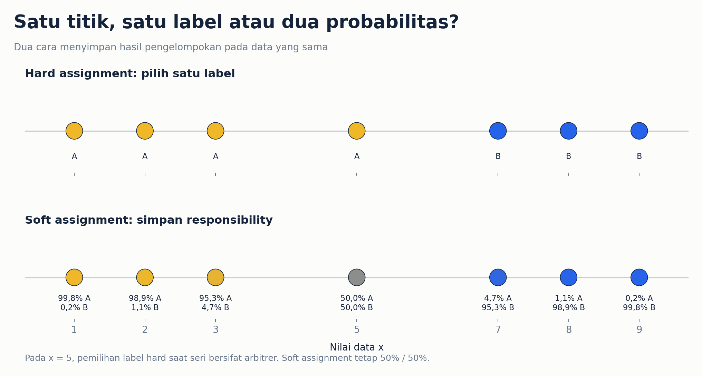
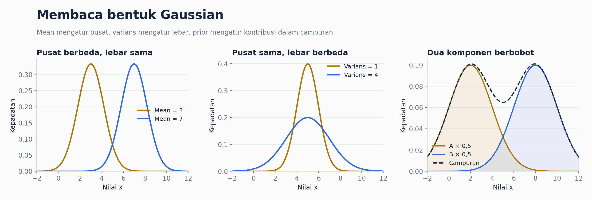
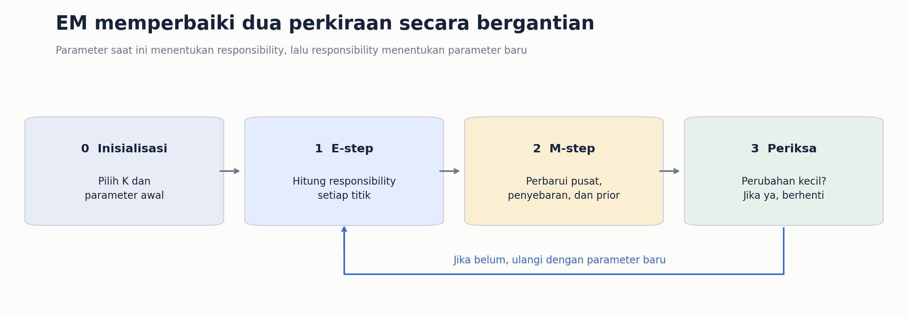
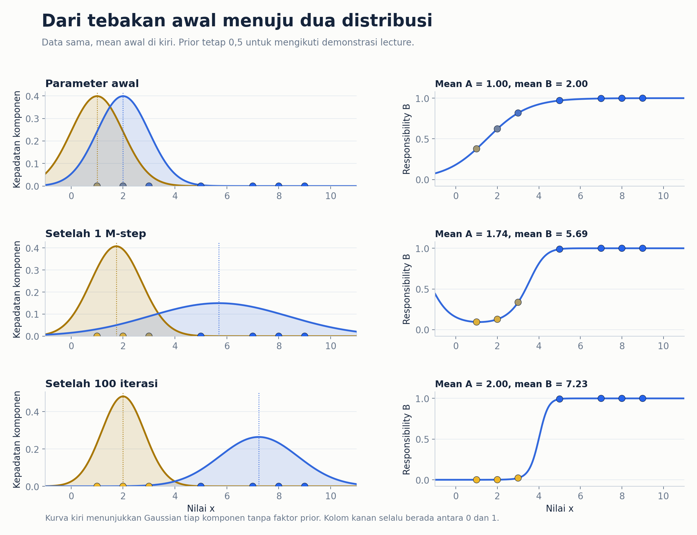
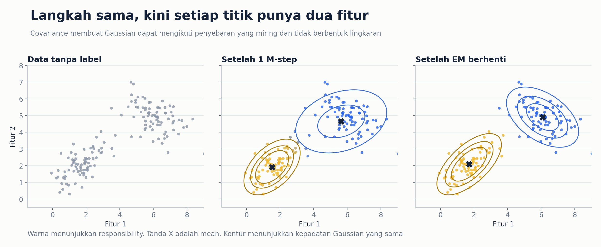
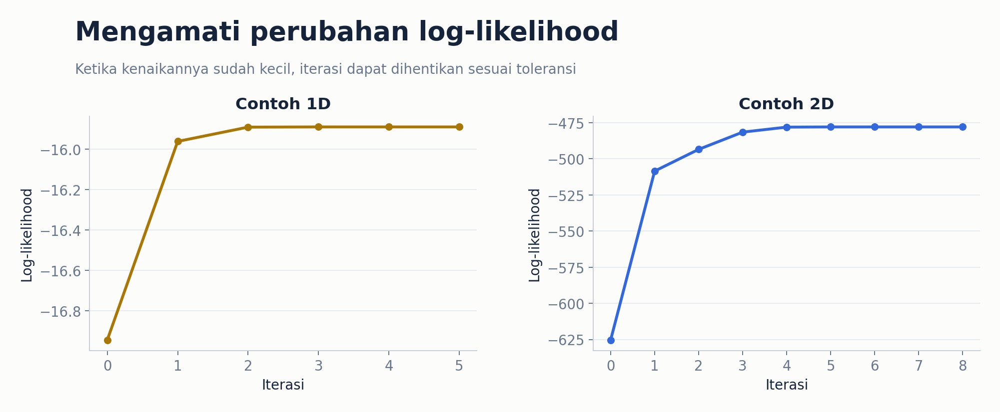

# Expectation Maximization dan Gaussian Mixture Model

## Daftar Isi

- [Definisi](#definisi)
- [Hard Clustering dan Soft Clustering](#hard-clustering-dan-soft-clustering)
- [Mengenal Gaussian Mixture Model](#mengenal-gaussian-mixture-model)
- [Mengapa Membutuhkan EM](#mengapa-membutuhkan-em)
- [Cara Kerja EM](#cara-kerja-em)
- [E-step Menghitung Responsibility](#e-step-menghitung-responsibility)
- [M-step Memperbarui Parameter](#m-step-memperbarui-parameter)
- [Contoh Perhitungan 1D](#contoh-perhitungan-1d)
- [Dari Data 1D ke Data 2D](#dari-data-1d-ke-data-2d)
- [Kapan Iterasi Berhenti](#kapan-iterasi-berhenti)
- [Menentukan Jumlah Komponen](#menentukan-jumlah-komponen)
- [Perbandingan dengan K-Means](#perbandingan-dengan-k-means)
- [Kelebihan dan Kekurangan](#kelebihan-dan-kekurangan)
- [Implementasi EM pada Data 1D](#implementasi-em-pada-data-1d)
- [Implementasi EM pada Data 2D](#implementasi-em-pada-data-2d)
- [Latihan](#latihan)
- [Referensi](#referensi)

## Definisi

**Expectation Maximization (EM)** adalah algoritma untuk memperkirakan parameter model ketika ada informasi yang tidak diketahui. Pada clustering, kita memiliki data, tetapi tidak mengetahui kelompok asal setiap data.

Dalam modul ini, EM digunakan untuk melatih **Gaussian Mixture Model (GMM)**. GMM menganggap data berasal dari campuran beberapa distribusi Gaussian. Setiap Gaussian mewakili satu komponen yang dapat kita gunakan sebagai klaster.

GMM dan EM memiliki peran berbeda. **GMM adalah model yang menggambarkan data**, sedangkan **EM adalah algoritma untuk mencari parameter model tersebut**. EM juga dapat digunakan pada model lain, tetapi pembahasan di sini berfokus pada GMM.

Alur pembahasan mengikuti lecture Victor Lavrenko pada `transcript.md` dan slide dalam `EM_vid_1`. Ilustrasi serta angka contoh dibuat ulang untuk modul ini. Pemetaan sumber tersedia pada bagian [Referensi](#referensi).

## Hard Clustering dan Soft Clustering

Pada **hard clustering**, setiap data diberi satu kelompok. Misalnya, K-Means menempatkan sebuah titik ke klaster A atau klaster B.

Pada **soft clustering**, kita menyimpan tingkat keterkaitan data dengan setiap kelompok. Sebuah titik dapat memiliki probabilitas 60% berasal dari komponen A dan 40% berasal dari komponen B.



*Ilustrasi dibuat ulang berdasarkan slide “Mixture models” [1]. Warna campuran menunjukkan ketidakpastian terhadap asal titik.*

Dalam GMM, setiap titik diasumsikan berasal dari satu komponen, tetapi identitas komponen itu tidak terlihat. Jadi, probabilitas 60% dan 40% menunjukkan **ketidakpastian kita tentang asal titik**, bukan berarti satu pengamatan benar-benar dihasilkan oleh dua komponen sekaligus.

| Aspek | Hard clustering | Soft clustering pada GMM |
|---|---|---|
| Hasil per data | Satu label klaster | Probabilitas untuk setiap komponen |
| Contoh | A | A = 0,6 dan B = 0,4 |
| Data di daerah tumpang tindih | Tetap diberi satu label | Ketidakpastiannya dapat dipertahankan |
| Kontribusi saat memperbarui pusat | Ke satu klaster | Dibagi sesuai probabilitasnya |

Jika akhirnya dibutuhkan satu label, kita dapat memilih komponen dengan probabilitas terbesar. Namun, **selama pelatihan EM, probabilitas tersebut tetap digunakan sebagai bobot**, tanpa dibulatkan menjadi 0 atau 1.

## Mengenal Gaussian Mixture Model

### 1. Satu Gaussian

Gaussian adalah distribusi berbentuk lonceng. Pada data satu dimensi, bentuknya ditentukan oleh dua parameter utama.

- **Mean, μ**, menunjukkan posisi pusat distribusi.
- **Varians, σ²**, menunjukkan seberapa menyebar data di sekitar pusat tersebut.

Mean yang berubah membuat lonceng bergeser. Varians kecil membuat lonceng lebih sempit dan tinggi. Varians besar membuatnya lebih lebar dan rendah.

**Standar deviasi, σ, adalah akar dari varians**. Perbedaan ini perlu diperhatikan saat menggunakan fungsi Python yang menerima standar deviasi.

### 2. Campuran Beberapa Gaussian

Misalkan terdapat dua sumber data, yaitu sumber kuning A dan sumber biru B. Masing-masing memiliki Gaussian sendiri.

Selain mean dan varians, GMM memiliki **bobot campuran** atau **prior**, yang ditulis sebagai π. Bobot ini menunjukkan proporsi data yang diperkirakan berasal dari setiap komponen.

Sebagai contoh, π_A = 0,4 dan π_B = 0,6 berarti model memperkirakan sekitar 40% pengamatan berasal dari A dan 60% berasal dari B. Seluruh bobot harus bernilai tidak negatif dan jumlahnya 1.

Untuk dua komponen, kepadatan gabungannya adalah:

$$
p(x)=\pi_A p(x\mid A)+\pi_B p(x\mid B).
$$

Artinya, model menggabungkan kepadatan dari A dan B sesuai proporsinya. Jumlah Gaussian yang digunakan disebut **K**, yaitu jumlah komponen yang kita tentukan sebelum menjalankan contoh EM ini.



*Ilustrasi baru berdasarkan gagasan slide “Mixture models in 1-d” [1]. Garis putus-putus pada panel kanan merupakan jumlah dua kurva berbobot.*

### 3. Kepadatan Berbeda dengan Probabilitas Keanggotaan

Nilai p(x | B) menjawab pertanyaan, “Seberapa sesuai posisi x dengan distribusi B?” Nilai ini adalah **kepadatan**, yang dibaca dari kurva Gaussian.

Sementara itu, P(B | x) menjawab pertanyaan, “Setelah melihat x, berapa probabilitas bahwa asalnya adalah B?” Nilai ini diperoleh setelah membandingkan seluruh komponen dan memperhitungkan prior.

Keduanya tidak boleh disamakan. Untuk data kontinu, tinggi kurva bukan probabilitas tepat pada satu nilai x. Probabilitas pada rentang nilai berkaitan dengan luas di bawah kurva. Kita cukup memakai tinggi kurva sebagai bahan perbandingan pada E-step.

## Mengapa Membutuhkan EM

Bayangkan kita memiliki titik-titik pada sebuah garis dan mengetahui bahwa titik tersebut berasal dari dua Gaussian.

**Jika asal setiap titik diketahui**, kita dapat menghitung mean dan varians masing-masing kelompok secara langsung. Untuk kelompok biru, kita mengambil titik-titik biru lalu menghitung rata-rata dan penyebarannya.

**Jika parameter Gaussian diketahui**, kita dapat membandingkan seberapa sesuai setiap titik dengan Gaussian kuning dan biru. Dari perbandingan tersebut, kita memperkirakan asal setiap titik.

Masalahnya, pada data tanpa label, **asal titik dan parameter Gaussian sama-sama belum diketahui**. Untuk mencari parameter, kita membutuhkan perkiraan asal titik. Untuk memperkirakan asal titik, kita membutuhkan parameter.

Lecture menyebutnya sebagai *chicken-and-egg problem*. EM mengatasinya dengan memulai dari tebakan parameter, lalu memperbaiki kedua perkiraan tersebut secara bergantian.

## Cara Kerja EM

EM pada GMM dijalankan melalui langkah berikut.

1. **Inisialisasi**. Tentukan K, lalu pilih mean, varians atau covariance, serta prior awal. Mean dapat dipilih secara acak. Pada contoh kode, mean awal ditetapkan agar proses mudah diulang.
2. **Expectation atau E-step**. Gunakan parameter saat ini untuk menghitung probabilitas asal setiap titik dari masing-masing komponen.
3. **Maximization atau M-step**. Gunakan probabilitas tersebut sebagai bobot untuk memperbarui mean, varians atau covariance, dan bila diperlukan prior.
4. **Periksa perubahan**. Ulangi E-step dan M-step sampai perubahan cukup kecil atau batas iterasi tercapai.



*Alur dibuat ulang berdasarkan slide “Expectation Maximization (EM)” [1].*

Satu putaran E-step dan M-step disebut **satu iterasi**. E-step memperkirakan asal data dengan parameter tetap. M-step memperbarui parameter menggunakan bobot dari E-step tersebut.

Nama *expectation* berkaitan dengan penggunaan perkiraan keanggotaan sebagai bobot. Nama *maximization* berkaitan dengan pemilihan parameter yang paling sesuai dengan data berdasarkan bobot tersebut. Kita tidak perlu menurunkan rumus optimasinya untuk mengikuti proses ini.

## E-step Menghitung Responsibility

Probabilitas keanggotaan pada E-step disebut **responsibility**. Dalam transcript, responsibility untuk komponen biru ditulis sebagai b_i dan untuk komponen kuning sebagai a_i.

Untuk setiap titik x_i, lakukan tiga hal.

1. Hitung kepadatan titik tersebut pada masing-masing Gaussian.
2. Kalikan setiap kepadatan dengan prior komponennya.
3. Bagi hasil setiap komponen dengan jumlah hasil seluruh komponen.

Untuk dua komponen, responsibility biru adalah:

$$
b_i=P(B\mid x_i)=\frac{p(x_i\mid B)\pi_B}{p(x_i\mid A)\pi_A+p(x_i\mid B)\pi_B}.
$$

Responsibility kuning adalah:

$$
a_i=1-b_i.
$$

Jika prior keduanya sama, perbandingan terutama ditentukan oleh kepadatan masing-masing Gaussian pada titik tersebut. Jika prior berbeda, komponen dengan proporsi lebih besar mendapat bobot awal lebih besar sebelum normalisasi.

Misalnya, hasil perkalian kepadatan dan prior adalah 0,02 untuk A dan 0,08 untuk B. Maka:

$$
b_i=\frac{0,08}{0,02+0,08}=0,8.
$$

Responsibility untuk A adalah 0,2. Jadi, titik tersebut memberi kontribusi lebih besar kepada B pada M-step.

### Titik Jauh Tetap Bisa Mendapat Responsibility Tinggi

Pada contoh lecture, sebuah titik berada jauh dari kedua Gaussian awal. Kepadatannya kecil pada Gaussian biru, tetapi jauh lebih kecil lagi pada Gaussian kuning. Setelah dinormalisasi, responsibility biru dapat mendekati 1.

Artinya, **B lebih masuk akal dibanding A menurut model saat ini**. Hal itu tidak otomatis berarti titik tersebut cocok dengan model secara keseluruhan. Responsibility merupakan perbandingan antar komponen yang tersedia.

## M-step Memperbarui Parameter

Setelah E-step, setiap titik memiliki bobot untuk A dan B. Kita menggunakan bobot tersebut untuk memperbarui Gaussian.

### 1. Mean sebagai Rata-Rata Berbobot

Mean biru diperbarui menggunakan:

$$
\mu_B^{\text{baru}}=\frac{\sum_i b_i x_i}{\sum_i b_i}.
$$

Pembilang menjumlahkan nilai data setelah dikalikan responsibility biru. Penyebut menjumlahkan seluruh responsibility biru.

Bayangkan sebuah titik memiliki b_i = 0,9. Titik tersebut memberikan kontribusi besar saat menghitung pusat biru. Titik dengan b_i = 0,1 tetap ikut dihitung, tetapi pengaruhnya lebih kecil.

Jika seluruh bobot hanya 0 atau 1, rumus ini menjadi rata-rata biasa dari titik yang dipilih. Inilah hubungan intuitifnya dengan K-Means. EM mempertahankan bobot pecahan sehingga satu titik dapat ikut memengaruhi beberapa pusat.

### 2. Varians sebagai Penyebaran Berbobot

Setelah mendapatkan mean baru, varians biru diperbarui menggunakan:

$$
(\sigma_B^2)^{\text{baru}}=\frac{\sum_i b_i(x_i-\mu_B^{\text{baru}})^2}{\sum_i b_i}.
$$

Kita menghitung jarak kuadrat setiap titik terhadap **mean baru**, lalu mengambil rata-rata berbobotnya. Jadi, titik yang responsibility birunya besar lebih berpengaruh terhadap lebar Gaussian biru.

Perhitungan untuk A sama, tetapi menggunakan a_i. Penyebutnya adalah jumlah bobot A. Kita memakai pembagi jumlah bobot, bukan jumlah bobot dikurangi satu, karena yang dicari adalah parameter Gaussian pada M-step.

Pada video kedua sekitar 7:07, pembicara mengoreksi salah tulis pada slide. Varians biru harus menggunakan mean biru. Rumus di atas sudah mengikuti koreksi tersebut dan memakai mean yang baru dihitung.

### 3. Prior sebagai Proporsi Berbobot

Prior biru dapat diperbarui menggunakan:

$$
\pi_B^{\text{baru}}=\frac{\sum_i b_i}{n}.
$$

Jika jumlah responsibility biru adalah 6 dari 10 data, prior biru yang baru adalah 0,6. Jumlah responsibility dapat berupa pecahan sehingga tidak harus sama dengan jumlah titik yang diberi label biru.

Lecture awalnya mempertahankan prior sama besar agar contoh mudah diikuti, kemudian menjelaskan cara memperbaruinya. **Kedua pilihan tersebut perlu dibedakan**. Prior tetap berarti proporsinya dibatasi sejak awal. Prior yang diperbarui berarti model ikut mempelajari proporsi setiap komponen.

Pada kedua implementasi di akhir modul, prior ikut diperbarui. Jika satu komponen memperoleh hampir seluruh bobot sejak awal, komponen lain dapat kehilangan pengaruh. Karena itu, pemilihan parameter awal tetap perlu diperhatikan.

## Contoh Perhitungan 1D

Gunakan tujuh data berikut:

$$
x=[1,2,3,5,7,8,9].
$$

Angka ini dibuat untuk modul, bukan salinan nilai titik pada slide. Misalkan K = 2 dengan parameter awal berikut.

| Parameter | A, kuning | B, biru |
|---|---:|---:|
| Mean | 2 | 8 |
| Varians | 4 | 4 |
| Prior | 0,5 | 0,5 |

### 1. E-step

Kita membandingkan kepadatan Gaussian A dan B pada setiap titik, mengalikan dengan prior, lalu melakukan normalisasi. Hasilnya dibulatkan menjadi empat angka di belakang koma.

| x_i | a_i, responsibility A | b_i, responsibility B |
|---:|---:|---:|
| 1 | 0,9975 | 0,0025 |
| 2 | 0,9890 | 0,0110 |
| 3 | 0,9526 | 0,0474 |
| 5 | 0,5000 | 0,5000 |
| 7 | 0,0474 | 0,9526 |
| 8 | 0,0110 | 0,9890 |
| 9 | 0,0025 | 0,9975 |

Titik x = 5 berada tepat di tengah kedua mean. Karena varians dan prior juga sama, responsibility-nya terbagi sama besar. Setiap baris berjumlah 1.

### 2. M-step

Jumlah responsibility untuk A adalah 3,5 dan untuk B juga 3,5. Kita dapat membacanya sebagai jumlah anggota efektif masing-masing komponen.

Dengan nilai responsibility sebelum pembulatan, jumlah nilai data berbobot untuk B sekitar 26,2246. Maka:

$$
\mu_B^{\text{baru}}=\frac{26,2246}{3,5}\approx 7,4927.
$$

Dengan cara yang sama, mean A yang baru sekitar 2,5073. Setelah penyebaran dihitung terhadap mean baru masing-masing, varians keduanya sekitar 2,0720.

| Parameter setelah satu M-step | A | B |
|---|---:|---:|
| Mean | 2,5073 | 7,4927 |
| Varians | 2,0720 | 2,0720 |
| Prior | 0,5 | 0,5 |

Mean bergeser karena seluruh titik ikut berkontribusi sesuai bobotnya. Titik tengah memberikan setengah kontribusi kepada A dan setengah kepada B.

### 3. Ulangi dengan Parameter Baru

Angka di atas belum merupakan hasil akhir. E-step berikutnya menggunakan mean dan varians baru, sehingga responsibility juga berubah. M-step kemudian memperbarui parameter lagi.



*Ilustrasi dihitung ulang mengikuti urutan slide “EM: 1-d example” [1]. Gambar sengaja dimulai dengan dua mean di sebelah kiri, berbeda dari tabel, agar perpindahan Gaussian terlihat jelas. Prior pada gambar dipertahankan 0,5 seperti demonstrasi awal lecture.*

Pada kolom kiri, Gaussian bergerak dan berubah lebar. Pada kolom kanan, garis menunjukkan responsibility biru. Titik yang semakin mendukung B akan memiliki nilai semakin dekat ke 1. Kedua kolom pada setiap baris menggunakan parameter yang sama.

## Dari Data 1D ke Data 2D

Pada data 1D, satu pengamatan hanya memiliki satu nilai, misalnya x = 3. Pada data 2D, satu pengamatan memiliki dua fitur, misalnya x = (3, 5).

Prinsip EM tetap sama. E-step menghitung responsibility. M-step menghitung parameter baru menggunakan responsibility tersebut.

| Parameter | Data 1D | Data 2D |
|---|---|---|
| Mean | Satu angka | Dua angka yang menunjukkan pusat |
| Penyebaran | Satu varians | Matriks covariance berukuran 2 × 2 |
| Bentuk yang divisualisasikan | Kurva lonceng | Kontur berbentuk elips atau lingkaran |
| Responsibility | Satu nilai per komponen untuk setiap data | Tetap satu nilai per komponen untuk setiap data |

**Covariance** menggambarkan penyebaran tiap fitur sekaligus bagaimana kedua fitur berubah bersama. Nilai diagonal merupakan varians masing-masing fitur. Nilai di luar diagonal menunjukkan kecenderungan perubahan bersama antara dua fitur.

Jika kedua fitur cenderung naik bersama, elips dapat miring ke arah kanan atas. Jika satu fitur naik ketika fitur lain turun, elips dapat miring ke arah sebaliknya. Jadi, Gaussian 2D tidak harus berbentuk lingkaran.



*Ilustrasi baru berdasarkan slide “Gaussian mixture models: d>1” [1]. Data sintetis dan hasil akhir sesuai contoh implementasi 2D. Garis kontur menunjukkan daerah dengan kepadatan sama, bukan batas klaster yang mutlak.*

Mean diperbarui dengan rata-rata berbobot untuk masing-masing fitur. Covariance diperbarui dengan melihat penyimpangan pasangan fitur terhadap mean baru, lalu mengambil rata-rata berbobotnya.

Kita tidak perlu menurunkan rumus Gaussian multidimensi untuk memahami alurnya. Pada kode 2D, SciPy menghitung kepadatan Gaussian, sedangkan E-step dan pembaruan parameter tetap ditulis secara langsung.

## Kapan Iterasi Berhenti

EM mencoba membuat model semakin sesuai dengan data. Kesesuaian ini diukur melalui **likelihood**, yaitu seberapa baik parameter model menjelaskan kumpulan data yang diamati.

Pada kode, kita memakai **log-likelihood**, yaitu bentuk logaritma dari likelihood. Nilainya lebih mudah dihitung karena kita menjumlahkan log kepadatan setiap data. Untuk data dan K yang sama, nilai lebih besar menunjukkan kecocokan yang lebih baik. Nilainya dapat negatif.

Kita menghentikan iterasi jika perubahan log-likelihood sudah sangat kecil. Batas jumlah iterasi juga dipakai agar proses tidak berjalan tanpa akhir.



*Grafik dihitung dari contoh kode 1D dan 2D dalam modul. Iterasi 0 menggunakan parameter awal. Skala kedua panel berbeda sehingga tinggi kurvanya tidak untuk dibandingkan antar dataset.*

Dalam perhitungan EM yang tepat, E-step dan M-step tidak menurunkan likelihood. Dalam kode numerik, pembulatan dan tambahan penstabil pada covariance dapat menimbulkan perbedaan kecil. Kurva contoh ini dapat digunakan untuk melihat apakah proses berjalan sesuai harapan.

**Berhenti bukan berarti menemukan solusi terbaik secara global**. Parameter awal berbeda dapat menghasilkan solusi berbeda. Untuk pemakaian lebih lanjut, jalankan beberapa inisialisasi lalu bandingkan hasilnya pada data dan K yang sama.

## Menentukan Jumlah Komponen

Pada contoh ini, K = 2 diberikan sejak awal. EM standar untuk GMM **tidak otomatis menentukan K**.

Slide “How to pick K?” menjelaskan bahwa kita tidak cukup memilih K berdasarkan likelihood data pelatihan terbesar. Menambah komponen dapat membuat model semakin mengikuti data pelatihan, tetapi hasilnya belum tentu baik untuk data baru.

Beberapa cara mempertimbangkan K adalah:

- Membandingkan kemampuan model menjelaskan data validasi yang tidak dipakai saat pelatihan.
- Menggunakan **AIC** atau **BIC**, yang mempertimbangkan kecocokan model sekaligus jumlah parameternya. Pada definisi AIC dan BIC yang umum digunakan dalam library, nilai lebih kecil lebih baik.
- Memeriksa apakah kelompok yang terbentuk masuk akal untuk data dan tujuan analisis.

Untuk memahami mekanisme EM, kita cukup menetapkan K = 2 terlebih dahulu. Pemilihan K merupakan langkah evaluasi model tersendiri. Dokumentasi GMM pada referensi [3] memberi pembahasan tambahan tentang pemilihan jumlah komponen.

Slide menampilkan bentuk skor BIC yang dimaksimalkan, sedangkan library umumnya memakai bentuk BIC yang diminimalkan. Arah pembacaan mengikuti definisi skornya. Gagasan utamanya tetap sama, yaitu mempertimbangkan kecocokan model dan kerumitannya.

## Perbandingan dengan K-Means

| Aspek | K-Means | GMM yang dilatih dengan EM |
|---|---|---|
| Representasi kelompok | Centroid | Distribusi Gaussian |
| Penugasan saat pelatihan | Satu klaster per titik | Responsibility untuk semua komponen |
| Perhitungan pusat | Rata-rata anggota klaster | Rata-rata berbobot responsibility |
| Penyebaran kelompok | Tidak dipelajari sebagai covariance tiap klaster | Varians atau covariance ikut dipelajari |
| Dasar penugasan | Jarak terhadap centroid | Kepadatan Gaussian dan prior |
| Jumlah kelompok | K ditentukan | K ditentukan pada contoh GMM ini |
| Pengaruh inisialisasi | Dapat memengaruhi hasil | Dapat memengaruhi hasil |

Keduanya sama-sama bergantian memperkirakan kelompok dan memperbarui representasi kelompok. Perbedaan pentingnya, GMM memperhitungkan **pusat, penyebaran, dan proporsi komponen**, sedangkan K-Means menggunakan jarak terhadap centroid.

Bagian akhir transcript menyatakan bahwa varians tetap dan prior seragam membuat GMM identik dengan K-Means. Pernyataan ini perlu diperjelas. Jika seluruh komponen memiliki penyebaran seragam yang sama pada semua arah serta prior sama, komponen dengan responsibility terbesar adalah yang pusatnya terdekat. Namun, EM tetap memperbarui mean dengan bobot pecahan. Agar langkah pembaruan pusat menjadi seperti K-Means, penugasannya juga harus dibuat tegas menjadi 0 atau 1.

## Kelebihan dan Kekurangan

**Kelebihan**

- Menyimpan ketidakpastian keanggotaan melalui responsibility.
- Dapat menggambarkan kelompok dengan penyebaran dan arah yang berbeda.
- Menghasilkan model kepadatan, sehingga informasi hasilnya lebih banyak daripada label klaster saja.

**Kekurangan**

- Membutuhkan pilihan jumlah komponen K.
- Peka terhadap parameter awal dan dapat berhenti pada solusi lokal.
- Hasil bergantung pada kecocokan asumsi Gaussian terhadap data.
- Varians atau covariance dapat menjadi sangat kecil jika komponen hanya mengikuti sedikit titik.
- Gaussian biasa tidak menyediakan label noise secara langsung seperti DBSCAN. Titik yang tidak cocok dengan seluruh komponen tetap mendapatkan responsibility.

Sebelum memakai data nyata, periksa nilai yang hilang dan skala fitur. Pada contoh berikut, data sengaja kecil dan fitur 2D memiliki skala yang sebanding agar perhatian tetap pada langkah EM.

## Implementasi EM pada Data 1D

Contoh ini memakai data yang sama dengan bagian perhitungan. Jalankan seluruh blok berikut dalam satu sel notebook atau satu berkas Python.

Library yang digunakan adalah **NumPy**, **SciPy**, dan **Matplotlib**. Jika belum tersedia, pasang dengan perintah berikut pada terminal environment Python yang digunakan.

```bash
python3 -m pip install numpy scipy matplotlib
```

SciPy hanya menghitung kepadatan Gaussian. Proses EM tetap kita tulis sendiri. `norm.pdf` menerima standar deviasi pada parameter `scale`, sehingga varians harus diakarkan terlebih dahulu [4].

```python
from __future__ import annotations

import matplotlib.pyplot as plt
import numpy as np
from scipy.stats import norm


def e_step_1d(
    x: np.ndarray,
    means: np.ndarray,
    variances: np.ndarray,
    weights: np.ndarray,
) -> tuple[np.ndarray, float]:
    # Kepadatan setiap titik dikalikan prior masing-masing komponen.
    scores = weights * norm.pdf(
        x[:, None], loc=means, scale=np.sqrt(variances)
    )
    total = scores.sum(axis=1, keepdims=True)
    if np.any(total <= 0) or not np.all(np.isfinite(total)):
        raise ValueError("Kepadatan tidak valid. Periksa data dan parameter awal.")
    # Normalisasi membuat responsibility setiap titik berjumlah 1.
    responsibility = scores / total
    log_likelihood = float(np.log(total).sum())
    return responsibility, log_likelihood


# 0. Data tanpa label dan inisialisasi dua Gaussian.
x = np.array([1, 2, 3, 5, 7, 8, 9], dtype=float)
means = np.array([2.0, 8.0])
variances = np.array([4.0, 4.0])
weights = np.array([0.5, 0.5])
MAX_ITER = 100
TOL = 1e-6
MIN_VARIANCE = 1e-6
MIN_MASS = 1e-8
converged = False
_, initial_ll = e_step_1d(x, means, variances, weights)
history = [initial_ll]

for iteration in range(1, MAX_ITER + 1):
    # 1. E-step: perkirakan asal setiap titik dengan parameter saat ini.
    responsibility, _ = e_step_1d(x, means, variances, weights)

    # 2. M-step: jumlah bobot menjadi banyak anggota efektif tiap komponen.
    effective_n = responsibility.sum(axis=0)
    if np.any(effective_n < MIN_MASS):
        raise ValueError("Komponen kehilangan bobot. Ganti inisialisasi.")

    # Mean diperbarui dengan rata-rata berbobot responsibility.
    means = (responsibility * x[:, None]).sum(axis=0) / effective_n

    # Varians memakai mean BARU. Batas kecil mencegah varians menjadi nol.
    squared_distance = (x[:, None] - means) ** 2
    variances = np.maximum(
        (responsibility * squared_distance).sum(axis=0) / effective_n,
        MIN_VARIANCE,
    )

    # Prior ikut dipelajari dari proporsi anggota efektif.
    weights = effective_n / len(x)

    # 3. Periksa kecocokan model setelah pembaruan parameter.
    _, current_ll = e_step_1d(x, means, variances, weights)
    history = history + [current_ll]
    if abs(history[-1] - history[-2]) < TOL:
        converged = True
        break

# Hitung ulang agar responsibility sesuai dengan parameter terakhir.
responsibility, _ = e_step_1d(x, means, variances, weights)
print("Iterasi:", iteration, "Konvergen:", converged)
print("Mean:", np.round(means, 4))
print("Varians:", np.round(variances, 4))
print("Prior:", np.round(weights, 4))
print("Kolom: x, responsibility A, responsibility B")
print(np.round(np.column_stack([x, responsibility]), 4))
if not converged:
    print("Batas iterasi tercapai. Hasil belum memenuhi toleransi.")

# Visualisasi komponen berbobot dan kepadatan campurannya.
grid = np.linspace(-1, 11, 400)
curves = weights * norm.pdf(
    grid[:, None], loc=means, scale=np.sqrt(variances)
)
fig, ax = plt.subplots(figsize=(8, 4))
ax.plot(grid, curves[:, 0], color="#b8860b", label="Komponen A berbobot")
ax.plot(grid, curves[:, 1], color="#2563eb", label="Komponen B berbobot")
ax.plot(grid, curves.sum(axis=1), "k--", label="Campuran")
ax.scatter(x, np.zeros_like(x), color="black", zorder=3, label="Data")
ax.set(xlabel="Nilai x", ylabel="Kepadatan", title="GMM 1D setelah EM")
ax.legend()
plt.tight_layout()
plt.show()
```

`responsibility` memiliki tujuh baris dan dua kolom. Kolom pertama adalah A dan kolom kedua adalah B. Pada setiap baris, kedua nilainya berjumlah 1.

Perhatikan x = 5. Karena data dan inisialisasi simetris, responsibility titik ini tetap sekitar 0,5 untuk kedua komponen. EM mempertahankan ketidakpastian tersebut selama perhitungan parameter.

`MIN_VARIANCE` membatasi varians agar tidak menjadi nol. `MIN_MASS` memeriksa apakah suatu komponen hampir kehilangan seluruh kontribusinya. `history` menyimpan log-likelihood, dimulai dari parameter awal.

## Implementasi EM pada Data 2D

Blok ini dapat dijalankan sendiri tanpa menjalankan contoh 1D. Kita membuat dua kelompok sintetis, kemudian menggabungkannya menjadi data **tanpa label** untuk pelatihan. Parameter pembangkit data hanya digunakan untuk membuat contoh, bukan diberikan kepada EM.

`X` berukuran 160 × 2. Ada 160 titik dengan dua fitur per titik. Seed generator NumPy ditetapkan menjadi 7 agar data contoh dapat diulang.

SciPy menerima pusat Gaussian melalui `mean` dan matriks covariance melalui `cov` [5]. Fungsi ini menghitung kepadatan Gaussian 2D sehingga kita tidak perlu menulis invers matriks secara manual.

```python
from __future__ import annotations

import matplotlib.pyplot as plt
import numpy as np
from scipy.stats import multivariate_normal


def e_step_2d(
    X: np.ndarray,
    means: np.ndarray,
    covariances: np.ndarray,
    weights: np.ndarray,
) -> tuple[np.ndarray, float]:
    # Setiap kolom berisi kepadatan berbobot untuk satu komponen.
    scores = np.column_stack([
        weights[k] * multivariate_normal.pdf(
            X, mean=means[k], cov=covariances[k]
        )
        for k in range(len(weights))
    ])
    total = scores.sum(axis=1, keepdims=True)
    if np.any(total <= 0) or not np.all(np.isfinite(total)):
        raise ValueError("Kepadatan tidak valid. Periksa data dan parameter awal.")
    return scores / total, float(np.log(total).sum())


def update_covariance(
    X: np.ndarray,
    mean: np.ndarray,
    responsibility: np.ndarray,
    effective_n: float,
    regularization: float,
) -> np.ndarray:
    # Penyimpangan dihitung terhadap mean BARU.
    difference = X - mean
    # @ menjumlahkan perkalian penyimpangan pasangan fitur secara berbobot.
    covariance = (responsibility[:, None] * difference).T @ difference
    covariance = covariance / effective_n
    # Tambahan kecil pada diagonal menjaga covariance dapat digunakan.
    return covariance + regularization * np.eye(X.shape[1])


# 0. Buat data contoh, lalu tentukan parameter awal untuk EM.
rng = np.random.default_rng(7)
X = np.vstack([
    rng.multivariate_normal([1.5, 2.0], [[0.8, 0.5], [0.5, 0.8]], size=80),
    rng.multivariate_normal([6.0, 5.0], [[1.1, -0.4], [-0.4, 0.7]], size=80),
])
means = np.array([[1.0, 1.0], [5.0, 4.0]])
covariances = np.array([2.0 * np.eye(2), 2.0 * np.eye(2)])
weights = np.array([0.5, 0.5])
MAX_ITER = 100
TOL = 1e-6
REGULARIZATION = 1e-6
MIN_MASS = 1e-8
converged = False
_, initial_ll = e_step_2d(X, means, covariances, weights)
history = [initial_ll]

for iteration in range(1, MAX_ITER + 1):
    # 1. E-step: hitung responsibility tiap titik untuk dua komponen.
    responsibility, _ = e_step_2d(X, means, covariances, weights)

    # 2. M-step: jumlahkan bobot dan perbarui pusat pada kedua fitur.
    effective_n = responsibility.sum(axis=0)
    if np.any(effective_n < MIN_MASS):
        raise ValueError("Komponen kehilangan bobot. Ganti inisialisasi.")
    means = (responsibility.T @ X) / effective_n[:, None]

    # Covariance baru mengikuti penyebaran titik dengan bobot yang sama.
    covariances = np.array([
        update_covariance(
            X, means[k], responsibility[:, k],
            float(effective_n[k]), REGULARIZATION,
        )
        for k in range(len(weights))
    ])
    weights = effective_n / len(X)

    # 3. Berhenti ketika perubahan log-likelihood sudah kecil.
    _, current_ll = e_step_2d(X, means, covariances, weights)
    history = history + [current_ll]
    if abs(history[-1] - history[-2]) < TOL:
        converged = True
        break

# Responsibility dihitung ulang menggunakan parameter terakhir.
responsibility, _ = e_step_2d(X, means, covariances, weights)
print("Iterasi:", iteration, "Konvergen:", converged)
print("Mean:\n", np.round(means, 3))
print("Prior:", np.round(weights, 3))
print("Covariance:\n", np.round(covariances, 3))
print("Responsibility lima titik pertama:\n", np.round(responsibility[:5], 3))
if not converged:
    print("Batas iterasi tercapai. Hasil belum memenuhi toleransi.")

# Warna campuran mempertahankan informasi soft assignment.
yellow = np.array([0.94, 0.72, 0.16])
blue = np.array([0.15, 0.39, 0.92])
colors = responsibility[:, :1] * yellow + responsibility[:, 1:] * blue
fig, ax = plt.subplots(figsize=(7, 5))
ax.scatter(X[:, 0], X[:, 1], c=colors, s=28, alpha=0.8)
ax.scatter(means[:, 0], means[:, 1], c="black", marker="X", s=120)

# Kontur memperlihatkan bentuk Gaussian sesuai covariance hasil EM.
grid_x, grid_y = np.meshgrid(np.linspace(-2, 9, 120), np.linspace(-1, 8, 120))
grid = np.dstack([grid_x, grid_y])
for k, color in enumerate(["#b8860b", "#2563eb"]):
    density = multivariate_normal.pdf(grid, mean=means[k], cov=covariances[k])
    ax.contour(grid_x, grid_y, density, levels=4, colors=[color], linewidths=1)
ax.set(xlabel="Fitur 1", ylabel="Fitur 2", title="GMM 2D setelah EM")
ax.set_aspect("equal", adjustable="box")
plt.tight_layout()
plt.show()
```

`responsibility` berukuran 160 × 2. Maknanya sama seperti contoh 1D. Perubahan utamanya terletak pada bentuk mean dan penyebaran. `means` berukuran 2 × 2, sedangkan `covariances` berukuran 2 × 2 × 2 karena ada dua komponen dengan matriks covariance masing-masing berukuran 2 × 2.

Pada `update_covariance`, `difference` berisi selisih setiap fitur terhadap mean baru. Operasi `@` adalah perkalian matriks untuk menjumlahkan hasil perkalian penyimpangan antar fitur. Hasil akhirnya menyimpan dua varians dan hubungan penyebaran antara kedua fitur.

`REGULARIZATION` menambahkan nilai kecil pada diagonal covariance. Ini membantu mencegah masalah perhitungan ketika suatu distribusi terlalu sempit. Tambahan ini adalah penstabil numerik, bukan langkah baru di luar siklus E-step dan M-step.

Kedua contoh memakai perhitungan kepadatan langsung agar alurnya mudah dibaca. Untuk data berdimensi tinggi atau titik yang sangat jauh dari semua komponen, kepadatan dapat terlalu kecil untuk disimpan komputer. Implementasi yang lebih umum memakai perhitungan dalam skala log. Pemeriksaan pada kode akan menghentikan proses jika jumlah kepadatan menjadi nol atau tidak valid.

## Referensi

1. **Victor Lavrenko. Lecture tentang mixture models, EM, dan GMM.** Sumber utama berupa [video lectures youtube](https://www.youtube.com/watch?v=BWXd5dOkuTo). 

2. **Ilustrasi dan contoh modul.** Semua gambar pada `assets/expectation-maximization/` dibuat baru berdasarkan gagasan slide [1]. Angka perhitungan, data sintetis, grafik iterasi, dan kode merupakan contoh yang disusun untuk modul ini. Warna kuning dan biru mengikuti penanda komponen pada lecture.
3. **Scikit-learn.** [Gaussian mixture models](https://scikit-learn.org/stable/modules/mixture.html). Referensi tambahan untuk penggunaan GMM, pemilihan jumlah komponen, inisialisasi, dan persoalan covariance.
4. **SciPy.** [scipy.stats.norm](https://docs.scipy.org/doc/scipy/reference/generated/scipy.stats.norm.html). Acuan fungsi kepadatan Gaussian 1D dan arti parameter `loc` serta `scale`.
5. **SciPy.** [scipy.stats.multivariate_normal](https://docs.scipy.org/doc/scipy/reference/generated/scipy.stats.multivariate_normal.html). Acuan fungsi kepadatan Gaussian multidimensi dan parameter `mean` serta `cov`.
