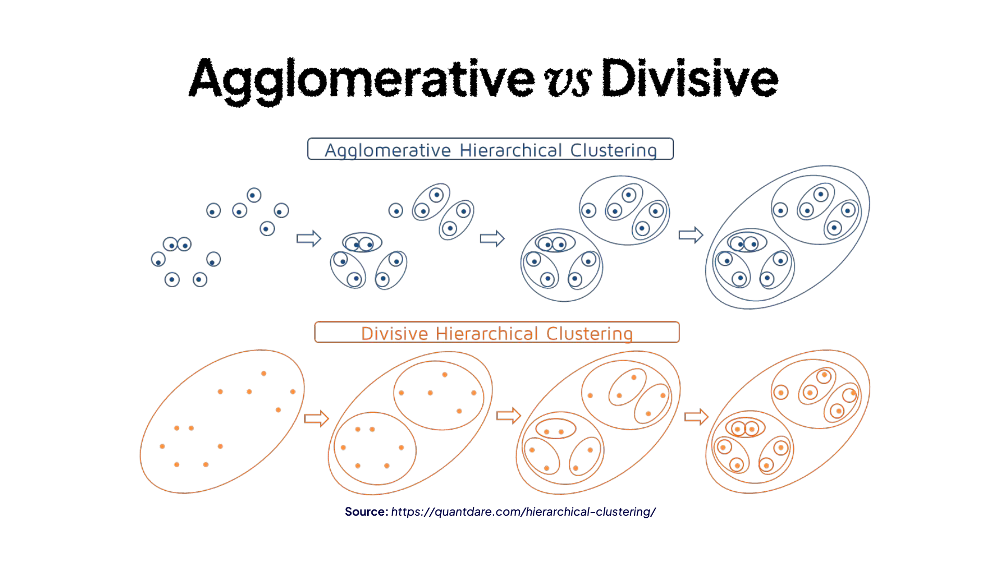
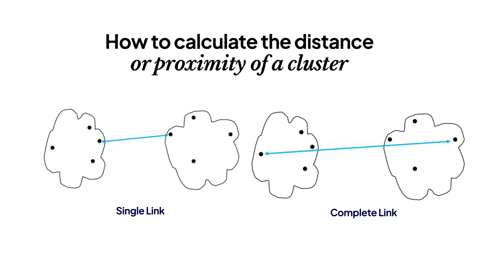
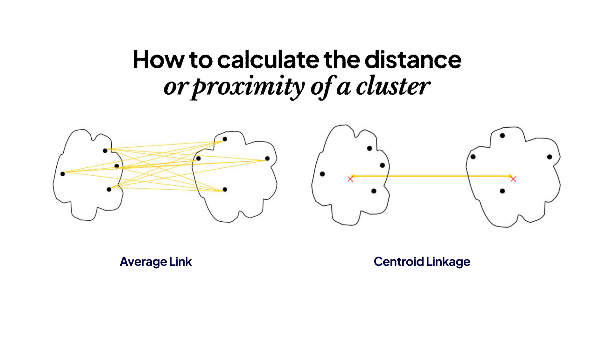
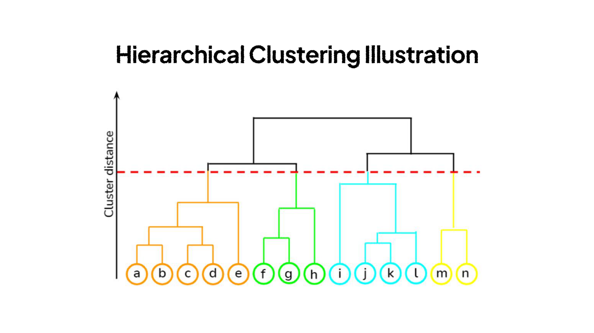
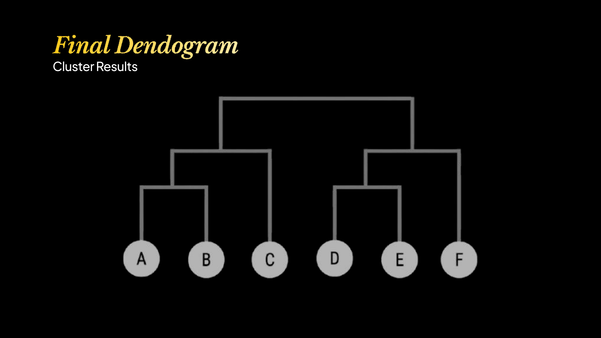
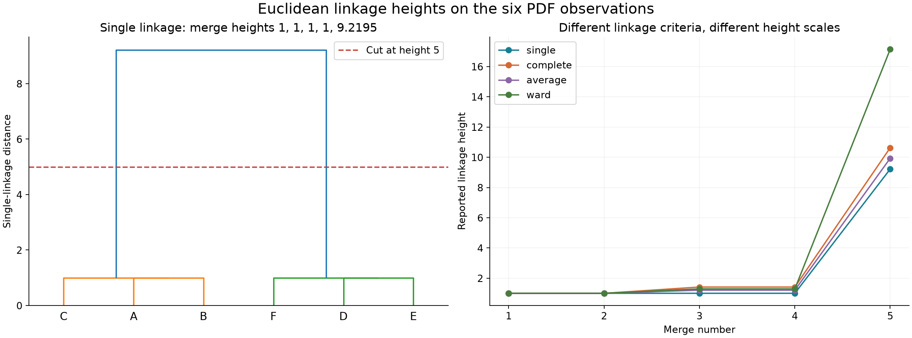

# Hierarchical Clustering

## Daftar Isi

- [Definisi](#definisi)
- [Jenis Hierarchical Clustering](#jenis-hierarchical-clustering)
- [Cara Kerja Agglomerative Clustering](#cara-kerja-agglomerative-clustering)
- [Menghitung Jarak Antar Data](#menghitung-jarak-antar-data)
- [Linkage Method](#linkage-method)
- [Membaca Dendrogram](#membaca-dendrogram)
- [Contoh Perhitungan](#contoh-perhitungan)
- [Menentukan Jumlah Klaster](#menentukan-jumlah-klaster)
- [Persiapan Data](#persiapan-data)
- [Implementasi](#implementasi)
- [Evaluasi](#evaluasi)
- [Kelebihan](#kelebihan)
- [Kekurangan](#kekurangan)
- [Kompleksitas Komputasi](#kompleksitas-komputasi)
- [Perbandingan dengan K-Means dan DBSCAN](#perbandingan-dengan-k-means-dan-dbscan)
- [Latihan](#latihan)
- [Referensi](#referensi)

## Definisi

**Hierarchical Clustering** adalah metode **Unsupervised Learning** yang mengelompokkan data ke dalam struktur hierarki. Hasilnya biasanya ditampilkan melalui **dendrogram**, yaitu diagram pohon yang menunjukkan hubungan antar data dan urutan pembentukan klaster.

Berbeda dengan K-Means yang langsung membentuk sejumlah klaster sesuai nilai K, hierarchical clustering menyimpan hubungan pengelompokan pada beberapa tingkat. Sebuah kelompok besar dapat terdiri dari beberapa subkelompok, lalu setiap subkelompok dapat diuraikan lagi sampai ke masing-masing data.

Struktur dendrogram terdiri dari:

- **Leaf**, yaitu simpul paling bawah yang mewakili satu data.
- **Internal node**, yaitu simpul yang mewakili penggabungan beberapa data atau subklaster.
- **Root**, yaitu simpul yang mencakup seluruh data pada hierarki lengkap.

Sebagai contoh, pengelompokan dokumen dapat menghasilkan kelompok besar bertema olahraga dan teknologi. Kelompok olahraga kemudian memiliki subkelompok sepak bola dan basket. Hubungan bertingkat seperti ini dapat terlihat dalam satu dendrogram.

Jumlah klaster tidak harus ditentukan sebelum hierarki lengkap dibentuk. Namun, untuk memperoleh hasil akhir berupa beberapa klaster, kita tetap perlu memilih tingkat pemotongan dendrogram atau menentukan jumlah klaster yang diinginkan.

## Jenis Hierarchical Clustering



*Ilustrasi pendekatan agglomerative dan divisive. Sumber: materi Unsupervised Learning, LBE KCV 2026.*

### 1. Agglomerative Hierarchical Clustering

**Agglomerative clustering** menggunakan pendekatan **bottom-up**. Setiap data awalnya dianggap sebagai satu klaster. Dua klaster yang paling dekat digabungkan, kemudian proses diulangi sampai terbentuk hierarki yang diinginkan.

Jika terdapat enam data, prosesnya dimulai dari enam klaster. Setiap penggabungan mengurangi jumlah klaster sebanyak satu. Untuk membentuk hierarki lengkap sampai seluruh data menjadi satu kelompok, diperlukan lima penggabungan.

Algoritma ini bersifat **greedy**. Setelah dua klaster digabungkan, penggabungan tersebut tidak dibatalkan untuk mencari susunan lain pada langkah berikutnya.

### 2. Divisive Hierarchical Clustering

**Divisive clustering** menggunakan pendekatan **top-down**. Seluruh data dimulai sebagai satu klaster, kemudian suatu klaster dipilih untuk dipecah menjadi kelompok yang lebih kecil.

Pemecahan dapat dilanjutkan sampai setiap data menjadi satu klaster atau dihentikan sesuai kebutuhan. Cara memilih klaster dan memecahnya bergantung pada algoritma yang digunakan. Karena itu, divisive clustering tidak cukup dijelaskan hanya sebagai proses memilih dua titik yang paling jauh.

Salah satu pendekatan pemecahan adalah menjalankan K-Means dengan K = 2 secara berulang pada kelompok yang dipilih. Pendekatan ini merupakan salah satu pilihan, bukan aturan yang berlaku untuk seluruh divisive clustering.

| Aspek | Agglomerative | Divisive |
|---|---|---|
| Kondisi awal | Setiap data menjadi satu klaster | Seluruh data berada dalam satu klaster |
| Operasi utama | Menggabungkan klaster | Memecah klaster |
| Arah pembentukan | Bottom-up | Top-down |
| Akhir hierarki lengkap | Satu klaster berisi seluruh data | Setiap data menjadi satu leaf |
| Keputusan utama | Jarak, linkage, dan aturan penghentian | Cara memilih kelompok, cara memecah, dan aturan penghentian |

Pembahasan perhitungan dan implementasi berikut menggunakan pendekatan agglomerative.

## Cara Kerja Agglomerative Clustering

Langkah-langkah agglomerative clustering adalah sebagai berikut.

1. **Membentuk klaster awal**. Setiap data ditempatkan dalam klasternya sendiri.
2. **Menghitung jarak antar data**. Hasil perhitungan disimpan sebagai informasi kedekatan, misalnya dalam matriks jarak.
3. **Memilih dua klaster terdekat**. Kedekatan antar klaster ditentukan oleh linkage method.
4. **Menggabungkan kedua klaster**. Dua kelompok tersebut diganti dengan satu kelompok baru.
5. **Memperbarui jarak antar klaster**. Jarak dari kelompok baru ke kelompok lainnya dihitung menggunakan linkage yang sama.
6. **Mengulangi proses**. Penggabungan dilanjutkan sampai tersisa satu klaster atau aturan penghentian terpenuhi.
7. **Membentuk dendrogram**. Setiap penggabungan dicatat beserta tinggi penggabungan dan jumlah anggotanya.

Pemilihan linkage harus konsisten sepanjang proses. Jika perhitungan dimulai dengan single linkage, pembaruan matriksnya juga harus menggunakan single linkage.

## Menghitung Jarak Antar Data

Misalkan setiap data memiliki d fitur. Jarak Euclidean antara data x dan y adalah:

$$
d(\mathbf{x},\mathbf{y})=\sqrt{\sum_{r=1}^{d}(x_r-y_r)^2}.
$$

Untuk A = (1, 1) dan B = (2, 1), jaraknya adalah:

$$
d(A,B)=\sqrt{(1-2)^2+(1-1)^2}=1.
$$

Pilihan lain mencakup Manhattan distance dan cosine dissimilarity. Pilihan jarak harus sesuai dengan makna fitur. Euclidean cocok untuk koordinat numerik yang skalanya dapat dibandingkan, sedangkan cosine sering digunakan untuk membandingkan arah vektor, misalnya pada representasi teks tertentu.

**Jarak antar data berbeda dengan jarak antar klaster**. Jarak antar data membandingkan dua observasi. Linkage menentukan cara menghitung kedekatan dua kelompok yang masing-masing dapat memiliki banyak anggota.

Matriks jarak simetris memiliki nilai nol pada diagonal utama. Nilai pada bagian atas dan bawah diagonal saling mencerminkan sehingga cukup disimpan salah satunya bila format implementasinya mendukung.

| Bentuk input | Ukuran | Isi |
|---|---|---|
| Matriks fitur | n × d | Satu baris untuk setiap data |
| Matriks jarak persegi | n × n | Jarak setiap pasangan data |
| Condensed distance vector | n(n-1)/2 | Satu nilai untuk setiap pasangan data yang berbeda |

Format ini perlu dibedakan saat menggunakan library. Fungsi `scipy.cluster.hierarchy.linkage` menerima matriks fitur atau condensed distance vector. Jika matriks jarak persegi diberikan sebagai matriks fitur, fungsi tersebut akan menghitung jarak antar baris matriks itu, bukan langsung memakai nilai jaraknya.

## Linkage Method

Misalkan A dan B adalah dua klaster. Banyak anggota masing-masing klaster ditulis sebagai |A| dan |B|, sedangkan centroid-nya ditulis sebagai μ_A dan μ_B.

### 1. Single Linkage

Single linkage menggunakan jarak pasangan data yang paling dekat dari kedua klaster:

$$
D_{\text{single}}(A,B)=\min_{\mathbf{x}\in A,\mathbf{y}\in B}d(\mathbf{x},\mathbf{y}).
$$

Setelah A dan B digabungkan, jarak kelompok baru ke klaster C adalah:

$$
D_{\text{single}}(A\cup B,C)=\min\{D(A,C),D(B,C)\}.
$$

Cukup ada satu pasangan anggota yang berdekatan untuk membuat dua klaster dianggap dekat. Karena itu, single linkage dapat mengikuti bentuk kelompok yang memanjang. Namun, sekumpulan titik penghubung dapat menyatukan dua kelompok yang sebenarnya berjauhan. Keadaan ini disebut **chaining effect**.

### 2. Complete Linkage

Complete linkage menggunakan jarak pasangan anggota yang paling jauh:

$$
D_{\text{complete}}(A,B)=\max_{\mathbf{x}\in A,\mathbf{y}\in B}d(\mathbf{x},\mathbf{y}).
$$

Pembaruan jaraknya adalah:

$$
D_{\text{complete}}(A\cup B,C)=\max\{D(A,C),D(B,C)\}.
$$

Metode ini menghindari penggabungan yang menghasilkan anggota dengan jarak sangat jauh di dalam satu kelompok. Hasilnya cenderung lebih kompak, tetapi keberadaan outlier dapat memengaruhi jarak maksimum secara kuat.



*Single linkage memakai pasangan terdekat, sedangkan complete linkage memakai pasangan terjauh. Sumber: materi Unsupervised Learning, LBE KCV 2026.*

### 3. Average Linkage

Average linkage menggunakan rata-rata jarak seluruh pasangan anggota yang berasal dari dua klaster:

$$
D_{\text{average}}(A,B)=\frac{1}{|A||B|}\sum_{\mathbf{x}\in A}\sum_{\mathbf{y}\in B}d(\mathbf{x},\mathbf{y}).
$$

Saat A dan B digabungkan, pembaruannya mempertimbangkan jumlah anggota:

$$
D_{\text{average}}(A\cup B,C)=\frac{|A|D(A,C)+|B|D(B,C)}{|A|+|B|}.
$$

Misalnya, A memiliki tiga anggota dan B memiliki satu anggota. Jika D(A,C) = 2 dan D(B,C) = 10, jarak setelah penggabungan menjadi:

$$
D(A\cup B,C)=\frac{3(2)+1(10)}{4}=4.
$$

Nilainya bukan 6 karena rata-rata sederhana kedua jarak tidak mempertimbangkan perbedaan jumlah anggota. Definisi ini dikenal sebagai **UPGMA**. Dalam **weighted linkage** atau **WPGMA**, kedua klaster anak mendapat bobot yang sama pada pembaruan, terlepas dari ukurannya.

### 4. Centroid Linkage

Centroid linkage mengukur jarak antara centroid kedua klaster:

$$
D_{\text{centroid}}(A,B)=\|\boldsymbol{\mu}_A-\boldsymbol{\mu}_B\|_2.
$$

Centroid hasil penggabungan dihitung dengan:

$$
\boldsymbol{\mu}_{A\cup B}=\frac{|A|\boldsymbol{\mu}_A+|B|\boldsymbol{\mu}_B}{|A|+|B|}.
$$

Rata-rata dua centroid hanya boleh dihitung dengan bobot yang sama jika kedua kelompok memiliki jumlah anggota yang sama.



*Average linkage mempertimbangkan seluruh pasangan anggota, sedangkan centroid linkage membandingkan rata-rata kelompok. Sumber: materi Unsupervised Learning, LBE KCV 2026.*

Centroid linkage dapat menghasilkan **dendrogram inversion**, yaitu penggabungan berikutnya berada pada tinggi yang lebih rendah daripada penggabungan sebelumnya. Contohnya adalah tiga titik (-1, 0), (1, 0), dan (0, 1.8). Dua titik pertama digabungkan pada jarak 2. Centroid-nya menjadi (0, 0), lalu jaraknya ke titik ketiga hanya 1.8.

Karena tinggi penggabungan tidak selalu meningkat, dendrogram dengan inversion perlu dibaca lebih hati-hati daripada dendrogram dengan tinggi yang monoton.

### 5. Ward Linkage

Ward linkage memilih penggabungan yang menghasilkan kenaikan paling kecil pada **within-cluster sum of squares** atau SSE. Biayanya adalah:

$$
\Delta\mathrm{SSE}(A,B)=\frac{|A||B|}{|A|+|B|}\|\boldsymbol{\mu}_A-\boldsymbol{\mu}_B\|_2^2.
$$

Ward tidak hanya mempertimbangkan jarak centroid, tetapi juga jumlah anggota kedua kelompok. Dua pasangan klaster dengan jarak centroid yang sama dapat memiliki biaya penggabungan berbeda.

Ward menggunakan geometri Euclidean agar kenaikan SSE memiliki makna tersebut. Pada `scikit-learn`, `linkage="ward"` hanya mendukung `metric="euclidean"`.

Dalam konvensi SciPy, tinggi Ward yang ditampilkan adalah:

$$
h_{\text{Ward}}=\sqrt{2\Delta\mathrm{SSE}}.
$$

Dengan demikian, angka pada sumbu vertikal dendrogram Ward tidak langsung sama dengan nilai kenaikan SSE. Definisi linkage dan konvensi library perlu diperhatikan sebelum membandingkan tinggi dendrogram.

### Perbandingan Hasil Linkage

Ambil A = {(1, 1), (2, 1)} dan B = {(1, 2)}. Nilai kedekatannya adalah:

| Metode | Perhitungan | Hasil |
|---|---|---:|
| Single | min(1, √2) | 1.0000 |
| Complete | max(1, √2) | 1.4142 |
| Average | (1 + √2)/2 | 1.2071 |
| Centroid | Jarak (1.5, 1) ke (1, 2) | 1.1180 |
| Kenaikan SSE Ward | (2 × 1/3) × 1.25 | 0.8333 |
| Tinggi Ward pada SciPy | √(2 × 0.8333…) | 1.2910 |

Perbedaan hasil ini menunjukkan bahwa linkage menentukan arti kedekatan antar kelompok. Tidak ada satu metode linkage yang selalu paling sesuai untuk seluruh dataset.

## Membaca Dendrogram



*Garis horizontal menentukan tingkat pemotongan dendrogram. Sumber: materi Unsupervised Learning, LBE KCV 2026.*

Pada dendrogram, tinggi pertemuan dua cabang menunjukkan nilai linkage ketika kedua kelompok digabungkan. Dua data dianggap berada dalam kelompok yang sama setelah cabang keduanya bertemu.

Sumbu horizontal menampilkan urutan leaf. Jarak horizontal antar label bukan ukuran jarak asli antar data. Cabang kiri dan kanan dapat ditukar tanpa mengubah hubungan pengelompokannya.

Untuk dendrogram dengan tinggi penggabungan yang monoton, garis horizontal dapat digunakan untuk menentukan kelompok. Cabang yang masih terpisah di bawah garis tersebut menjadi klaster yang berbeda.

Tinggi saat dua data pertama kali berada dalam satu kelompok disebut **cophenetic distance**. Nilai ini berasal dari hierarki dan tidak harus sama dengan jarak asli kedua data.

## Contoh Perhitungan

Gunakan enam titik berikut dengan **Euclidean distance** dan **single linkage**:

| Data | x | y |
|---|---:|---:|
| A | 1 | 1 |
| B | 2 | 1 |
| C | 1 | 2 |
| D | 8 | 8 |
| E | 9 | 8 |
| F | 8 | 9 |


### 1. Membentuk Matriks Jarak Awal

Sebagai contoh, jarak B ke D adalah:

$$
d(B,D)=\sqrt{(2-8)^2+(1-8)^2}=\sqrt{85}\approx9.2195.
$$

Matriks jarak lengkapnya adalah:

| Klaster | A | B | C | D | E | F |
|---|---:|---:|---:|---:|---:|---:|
| A | 0.0000 | 1.0000 | 1.0000 | 9.8995 | 10.6301 | 10.6301 |
| B | 1.0000 | 0.0000 | 1.4142 | 9.2195 | 9.8995 | 10.0000 |
| C | 1.0000 | 1.4142 | 0.0000 | 9.2195 | 10.0000 | 9.8995 |
| D | 9.8995 | 9.2195 | 9.2195 | 0.0000 | 1.0000 | 1.0000 |
| E | 10.6301 | 9.8995 | 10.0000 | 1.0000 | 0.0000 | 1.4142 |
| F | 10.6301 | 10.0000 | 9.8995 | 1.0000 | 1.4142 | 0.0000 |

Beberapa pasangan memiliki jarak terkecil yang sama, yaitu 1. Untuk contoh ini, penggabungan dimulai dari A dan B.

### 2. Menggabungkan A dan B

Setelah AB terbentuk, jaraknya ke setiap klaster lain dihitung menggunakan nilai minimum. Contohnya:

$$
D(AB,D)=\min\{d(A,D),d(B,D)\}=9.2195.
$$

| Klaster | AB | C | D | E | F |
|---|---:|---:|---:|---:|---:|
| AB | 0.0000 | 1.0000 | 9.2195 | 9.8995 | 10.0000 |
| C | 1.0000 | 0.0000 | 9.2195 | 10.0000 | 9.8995 |
| D | 9.2195 | 9.2195 | 0.0000 | 1.0000 | 1.0000 |
| E | 9.8995 | 10.0000 | 1.0000 | 0.0000 | 1.4142 |
| F | 10.0000 | 9.8995 | 1.0000 | 1.4142 | 0.0000 |

### 3. Menggabungkan AB dengan C

Jarak AB ke C adalah min(1, √2) = 1. Setelah keduanya digabungkan, terbentuk ABC.

| Klaster | ABC | D | E | F |
|---|---:|---:|---:|---:|
| ABC | 0.0000 | 9.2195 | 9.8995 | 9.8995 |
| D | 9.2195 | 0.0000 | 1.0000 | 1.0000 |
| E | 9.8995 | 1.0000 | 0.0000 | 1.4142 |
| F | 9.8995 | 1.0000 | 1.4142 | 0.0000 |

Misalnya, jarak ABC ke E berasal dari nilai minimum jarak A-E, B-E, dan C-E, yaitu 9.8995.

### 4. Menggabungkan D dan E

D dan E memiliki jarak 1. Penggabungannya menghasilkan matriks berikut.

| Klaster | ABC | DE | F |
|---|---:|---:|---:|
| ABC | 0.0000 | 9.2195 | 9.8995 |
| DE | 9.2195 | 0.0000 | 1.0000 |
| F | 9.8995 | 1.0000 | 0.0000 |

### 5. Menggabungkan DE dengan F

Jarak DE ke F adalah:

$$
D(DE,F)=\min\{d(D,F),d(E,F)\}=\min\{1,\sqrt2\}=1.
$$

Setelah DEF terbentuk, tersisa dua klaster:

| Klaster | ABC | DEF |
|---|---:|---:|
| ABC | 0.0000 | 9.2195 |
| DEF | 9.2195 | 0.0000 |

### 6. Menggabungkan ABC dengan DEF

Jarak minimum antar kedua kelompok berasal dari B-D atau C-D, yaitu √85. Penggabungan terakhir terjadi pada tinggi sekitar 9.2195.

| Klaster | ABCDEF |
|---|---:|
| ABCDEF | 0.0000 |

Urutan penggabungan dapat dirangkum sebagai berikut.

| Langkah | Penggabungan | Tinggi | Jumlah anggota hasil penggabungan | Klaster tersisa |
|---:|---|---:|---:|---:|
| 1 | A dengan B | 1.0000 | 2 | 5 |
| 2 | AB dengan C | 1.0000 | 3 | 4 |
| 3 | D dengan E | 1.0000 | 2 | 3 |
| 4 | DE dengan F | 1.0000 | 3 | 2 |
| 5 | ABC dengan DEF | 9.2195 | 6 | 1 |



*Skema hubungan pengelompokan enam titik. Sumber: materi Unsupervised Learning, LBE KCV 2026. Tinggi cabang pada gambar ini bersifat ilustratif dan tidak memakai skala numerik.*

Empat penggabungan awal sebenarnya terjadi pada tinggi yang sama, yaitu 1. Dendrogram dengan skala numerik memperlihatkannya sebagai berikut.



*Hasil perhitungan pada enam titik contoh. Bagian kiri menggunakan single linkage dengan garis potong pada tinggi 5. Bagian kanan memperlihatkan perbedaan tinggi penggabungan untuk beberapa linkage.*

### Pengaruh Jarak yang Sama

Pada contoh ini terdapat beberapa pasangan dengan jarak minimum yang sama atau **ties**. Algoritma dapat memilih D-E lebih dahulu daripada AB-C tanpa melanggar aturan single linkage.

Akibatnya, urutan penggabungan dan susunan cabang dapat berbeda antar implementasi atau urutan input. Namun, pemotongan pada tinggi 5 tetap menghasilkan kelompok {A, B, C} dan {D, E, F}.

Karena empat penggabungan awal terjadi pada tinggi 1, pemotongan berdasarkan ambang jarak tidak dapat menghasilkan setiap jumlah klaster antara satu dan enam. Jika diminta tepat tiga klaster, program harus memilih urutan tertentu di antara penggabungan yang memiliki jarak sama.

## Menentukan Jumlah Klaster

Ada dua cara yang umum digunakan:

1. **Memilih distance threshold**. Dendrogram dipotong pada tinggi tertentu, lalu jumlah kelompok mengikuti cabang yang masih terpisah.
2. **Menentukan jumlah klaster**. Hierarki dipotong agar menghasilkan K kelompok sesuai kebutuhan analisis.

Untuk contoh enam titik, ambang yang lebih besar dari 1 dan lebih kecil dari √85 menghasilkan dua klaster. Terlihat lonjakan tinggi yang besar antara penggabungan keempat dan kelima.

Lonjakan tersebut dapat menjadi alasan memilih dua kelompok pada contoh ini. Pada data nyata, keputusan juga perlu mempertimbangkan ukuran klaster, makna kelompok, stabilitas, serta evaluasi yang sesuai. Celah pada dendrogram saja tidak membuktikan bahwa suatu jumlah klaster merupakan satu-satunya jawaban yang benar.

## Persiapan Data

### Scaling

Jika satu fitur menggunakan nilai jutaan dan fitur lain menggunakan nilai satuan, fitur berskala besar dapat mendominasi perhitungan jarak. Standardization mengubah fitur menggunakan rata-rata dan standar deviasinya:

$$
\widetilde{x}_{ij}=\frac{x_{ij}-m_j}{s_j}.
$$

Scaling perlu mengikuti makna fitur. Untuk contoh koordinat sebelumnya, scaling tidak digunakan agar perhitungan tetap mengikuti koordinat yang diberikan. Pada data dengan satuan berbeda, pengaruh scaling perlu diperiksa sebelum menafsirkan dendrogram.

### Missing Value, Outlier, dan Pemilihan Fitur

Missing value perlu ditangani sebelum menghitung jarak. Kolom identifier seperti nomor pelanggan sebaiknya tidak dimasukkan jika nilainya tidak mewakili kemiripan.

Outlier dapat memengaruhi penggabungan, tetapi tidak boleh langsung dihapus tanpa memahami asalnya. Pada single linkage, titik penghubung dapat menyatukan kelompok. Pada complete linkage, satu titik ekstrem dapat memperbesar jarak maksimum.

Fitur yang berulang atau sangat berkorelasi juga dapat memberi bobot berlebih pada satu aspek data. [Dimensionality reduction](Dimensionality-Reduction.md) dapat dipertimbangkan, tetapi jumlah komponen dan perubahan jaraknya perlu dievaluasi karena informasi penting dapat ikut terbuang.

### Connectivity Constraint

Beberapa implementasi dapat membatasi penggabungan menggunakan graph kedekatan. Pada data spasial, misalnya, hanya kelompok yang bertetangga yang diperbolehkan bergabung.

Batasan tersebut memasukkan pengetahuan tambahan ke dalam model. Hasilnya dapat berbeda dari pengelompokan tanpa batasan sehingga cara membentuk graph perlu dijelaskan.

## Implementasi

Library yang digunakan adalah `NumPy`, `SciPy`, `scikit-learn`, dan `Matplotlib`.

```bash
python3 -m pip install numpy scipy scikit-learn matplotlib
```

### 1. Membentuk Dendrogram dan Memotong Hierarki

Contoh berikut menggunakan data yang sama dengan perhitungan manual.

```python
import matplotlib.pyplot as plt
import numpy as np
from scipy.cluster.hierarchy import dendrogram, fcluster, linkage
from scipy.spatial.distance import pdist, squareform

X = np.array(
    [[1, 1], [2, 1], [1, 2], [8, 8], [9, 8], [8, 9]],
    dtype=float,
)
nama_data = list("ABCDEF")

# pdist menghasilkan condensed distance vector.
jarak = pdist(X, metric="euclidean")
matriks_jarak = squareform(jarak)
Z = linkage(jarak, method="single")

# Ambang 5 berada di antara tinggi penggabungan 1 dan sqrt(85).
labels = fcluster(Z, t=5.0, criterion="distance")

print("Matriks jarak:\n", np.round(matriks_jarak, 4))
print("Linkage matrix:\n", Z)
print("Label klaster:", labels)

fig, ax = plt.subplots(figsize=(8, 5))
dendrogram(Z, labels=nama_data, color_threshold=5.0, ax=ax)
ax.axhline(5.0, color="red", linestyle="--", label="Ambang jarak 5")
ax.set(xlabel="Data", ylabel="Jarak single linkage", title="Dendrogram")
ax.legend()
fig.tight_layout()
plt.show()
```

Kelompok yang terbentuk adalah {A, B, C} dan {D, E, F}. Nilai label dapat berbeda karena nomor klaster hanyalah identifier.

Untuk n data, `Z` memiliki ukuran `(n - 1, 4)`. Setiap baris berisi ID dua klaster yang digabungkan, tinggi penggabungan, dan jumlah anggota kelompok baru. Data awal menggunakan ID 0 sampai n-1. Kelompok yang terbentuk pada baris r mendapat ID n+r.

### 2. Menggunakan AgglomerativeClustering

```python
import numpy as np
from sklearn.cluster import AgglomerativeClustering
from sklearn.metrics import silhouette_score

X = np.array(
    [[1, 1], [2, 1], [1, 2], [8, 8], [9, 8], [8, 9]],
    dtype=float,
)

model = AgglomerativeClustering(
    n_clusters=None,
    distance_threshold=5.0,
    metric="euclidean",
    linkage="single",
    compute_full_tree=True,
    compute_distances=True,
)
labels = model.fit_predict(X)

print("Label klaster:", labels)
print("Jumlah klaster:", np.unique(labels).size)
print("Tinggi penggabungan:", model.distances_)
print("Silhouette score:", silhouette_score(X, labels))
```

Jika `distance_threshold` digunakan, `n_clusters` harus diisi `None` dan hierarki lengkap perlu dibentuk. Jika ingin menentukan jumlah kelompok secara langsung, gunakan `n_clusters=K` dan biarkan `distance_threshold=None`.

Untuk mencoba Ward, gunakan `linkage="ward"` bersama `metric="euclidean"`. Jika dendrogram juga dibuat dengan SciPy, samakan linkage, jarak, data, dan preprocessing agar dendrogram benar-benar menjelaskan model yang dipasang.

### 3. Contoh Dendrogram Inversion

```python
import numpy as np
from scipy.cluster.hierarchy import linkage

X = np.array([[-1.0, 0.0], [1.0, 0.0], [0.0, 1.8]])
Z = linkage(X, method="centroid", metric="euclidean")

print("Tinggi penggabungan:", Z[:, 2])
```

Tinggi yang dihasilkan adalah 2 dan 1.8. Contoh ini menunjukkan bahwa centroid linkage dapat menghasilkan penggabungan berikutnya pada tinggi yang lebih rendah.

## Evaluasi

### Silhouette Score

Silhouette score membandingkan rata-rata jarak suatu data ke kelompoknya sendiri dengan rata-rata jarak ke kelompok lain yang paling dekat. Untuk data i:

$$
s(i)=\frac{b(i)-a(i)}{\max\{a(i),b(i)\}}.
$$

Nilai a(i) adalah rata-rata jarak ke anggota lain dalam klaster yang sama. Nilai b(i) adalah rata-rata jarak terkecil ke anggota suatu klaster lain.

Nilai mendekati 1 menunjukkan pemisahan yang baik menurut jarak tersebut. Nilai mendekati 0 menunjukkan kedekatan dengan batas kelompok. Nilai negatif berarti data rata-rata lebih dekat ke klaster lain.

Pada enam titik dengan hasil dua kelompok di atas, rata-rata silhouette sekitar 0.8853. Skor ini mengukur pemisahan geometris, bukan accuracy klasifikasi. Perhitungannya memerlukan setidaknya dua klaster dan jumlah klaster yang lebih kecil dari jumlah data.

### Cophenetic Correlation

Cophenetic correlation membandingkan jarak asli antar data dengan tinggi dendrogram saat masing-masing pasangan pertama kali bergabung. Korelasi tinggi menunjukkan bahwa hierarki cukup mewakili hubungan jarak yang diberikan.

Ukuran ini tidak langsung menentukan apakah suatu pemotongan bermanfaat. Sebuah hierarki dapat merangkum jarak dengan baik, tetapi kelompok akhirnya tetap tidak sesuai dengan tujuan analisis.

### Stabilitas dan Makna Kelompok

Stabilitas dapat diperiksa dengan perubahan kecil yang masuk akal pada data, pemilihan fitur, atau sampel. Bandingkan apakah pasangan data yang penting tetap berada dalam kelompok yang sama.

Interpretasi juga perlu melihat profil anggota, ukuran kelompok, dan relevansinya terhadap masalah. Jika label pembanding tersedia secara independen, ukuran seperti adjusted Rand index dapat digunakan untuk membandingkan hasil tanpa menganggap nomor klaster sama dengan nomor kelas.

## Kelebihan

- **Menampilkan hubungan bertingkat**. Satu hierarki memperlihatkan kelompok besar beserta subkelompoknya.
- **Tidak harus memilih K sebelum membentuk hierarki lengkap**. Beberapa tingkat pengelompokan dapat dibandingkan setelah dendrogram terbentuk.
- **Mendukung beberapa definisi kedekatan**. Jarak dan linkage dapat dipilih sesuai karakteristik data.
- **Mudah ditelusuri pada dataset kecil**. Urutan penggabungan dapat diperiksa satu per satu melalui matriks dan dendrogram.
- **Dapat mengikuti bentuk tertentu yang tidak bulat**. Single linkage, misalnya, mengikuti keterhubungan antar titik, meskipun tetap rentan terhadap chaining.

## Kekurangan

- **Penggabungan bersifat tetap**. Keputusan awal yang kurang sesuai dapat memengaruhi seluruh hierarki berikutnya.
- **Sensitif terhadap representasi dan linkage**. Perubahan fitur, scaling, atau aturan kedekatan dapat menghasilkan pohon berbeda.
- **Dapat terpengaruh noise dan outlier**. Bentuk pengaruhnya bergantung pada linkage.
- **Membutuhkan sumber daya besar untuk data berukuran besar**. Penyimpanan jarak berpasangan dapat menjadi kendala.
- **Dendrogram besar sulit dibaca**. Ribuan leaf tidak selalu dapat ditampilkan dengan jelas dalam satu gambar.
- **Tidak memiliki aturan prediksi data baru yang berlaku untuk semua linkage**. `AgglomerativeClustering` tidak menyediakan `predict` seperti K-Means.

Menempatkan data baru ke centroid klaster terdekat dapat dibuat sebagai aturan tambahan. Namun, hasilnya tidak selalu sama dengan membentuk ulang hierarki, terutama jika kelompok awal menggunakan single, complete, atau average linkage.

## Kompleksitas Komputasi

Menurut dokumentasi SciPy, implementasi single, complete, average, weighted, dan Ward linkage yang disediakan memiliki kompleksitas waktu O(n²). Metode lain yang menggunakan implementasi naif, termasuk centroid dan median linkage, memiliki kompleksitas O(n³). Implementasi dense tersebut membutuhkan memori O(n²).

Angka ini menjelaskan implementasi yang dimaksud dalam dokumentasi, bukan seluruh algoritma hierarchical clustering yang mungkin dibuat. Connectivity constraint atau algoritma khusus dapat memiliki perilaku berbeda.

Sebagai gambaran, matriks jarak penuh untuk 10.000 data memuat 100 juta nilai. Jika setiap nilai disimpan sebagai float64 berukuran 8 byte, matriks tersebut membutuhkan sekitar 0.8 GB, belum termasuk kebutuhan lain. Condensed distance vector mengurangi penyimpanan menjadi sekitar setengahnya.

Memotong tampilan dendrogram tidak mengurangi biaya pembentukan hierarki yang sudah dihitung. Untuk data besar, pertimbangkan kebutuhan analisis, pembatasan graph yang sesuai, atau metode clustering lain.

## Perbandingan dengan K-Means dan DBSCAN

| Aspek | Hierarchical Agglomerative | K-Means | DBSCAN |
|---|---|---|---|
| Dasar pengelompokan | Penggabungan menurut linkage | Kedekatan ke centroid | Keterhubungan daerah padat |
| Hasil utama | Hierarki yang dapat dipotong | Partisi sejumlah K klaster | Klaster dan kemungkinan noise |
| Parameter penting | Jarak, linkage, dan aturan pemotongan | K, scaling, dan inisialisasi | Radius tetangga dan kepadatan minimum |
| Noise | Umumnya tetap masuk hierarki | Selalu mendapat klaster | Dapat diberi label noise |
| Data baru | Tidak ada aturan `predict` umum | Dapat memakai centroid yang sudah dipelajari | Tidak berupa aturan centroid umum |
| Risiko utama | Penggabungan tetap dan pengaruh linkage | Geometri centroid yang tidak sesuai | Sensitivitas terhadap skala dan kepadatan |

Ward dan K-Means sama-sama berkaitan dengan SSE, tetapi prosedur optimasinya berbeda. Pemotongan hierarki Ward tidak harus menghasilkan kelompok yang sama dengan K-Means pada nilai K yang sama.

## Latihan

1. Hitung jarak AB ke C setelah A dan B digabungkan menggunakan single, complete, dan average linkage.
2. Jelaskan mengapa ambang jarak 5 menghasilkan dua klaster pada contoh enam titik.
3. Apakah urutan penggabungan harus selalu sama ketika terdapat ties?
4. Jelaskan perbedaan centroid linkage dan Ward linkage.
5. Ubah implementasi menjadi complete dan average linkage, lalu bandingkan tinggi penggabungannya.
6. Kalikan fitur x dengan 100 dan periksa perubahan hasil sebelum serta setelah scaling.

Untuk soal pertama, hasilnya masing-masing adalah 1, √2, dan (1 + √2)/2. Perbedaan tersebut berasal dari definisi kedekatan kelompok, bukan dari perubahan jarak antar titik.

## Referensi

- [Scikit-learn: Hierarchical Clustering](https://scikit-learn.org/stable/modules/clustering.html#hierarchical-clustering), penjelasan linkage dan connectivity constraint.
- [Scikit-learn: AgglomerativeClustering](https://scikit-learn.org/stable/modules/generated/sklearn.cluster.AgglomerativeClustering.html), parameter dan atribut model.
- [SciPy: scipy.cluster.hierarchy.linkage](https://docs.scipy.org/doc/scipy/reference/generated/scipy.cluster.hierarchy.linkage.html), definisi linkage, format hasil, serta kompleksitas implementasi.
- [Scikit-learn: silhouette_score](https://scikit-learn.org/stable/modules/generated/sklearn.metrics.silhouette_score.html), definisi silhouette dan ketentuan jumlah klaster.
